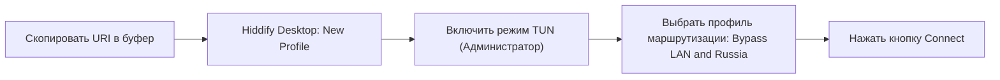
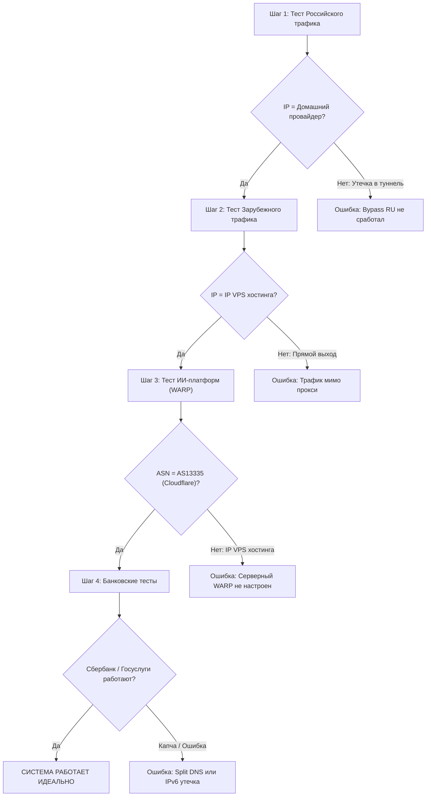

# Практическое руководство: Архитектурное разделение конфигурации между сервером и клиентскими устройствами (Sing-box, VLESS Reality, Hysteria 2, WARP)

> **Статус документа:** Исчерпывающее практическое руководство и эталонная архитектура  
> **Целевая аудитория:** Архитекторы распределенных сетей, DevOps-инженеры, системные администраторы, разработчики `vpn-installer`  
> **Ключевой стек:** Sing-box (v1.10+ / v1.11+), VLESS + Reality (XTLS-Vision), Hysteria 2 (Salamander obfs + Port Hopping), Shadowsocks-2022, Cloudflare WARP, TUN (L3 / gVisor / System), uTLS, Split Routing & Split DNS.

---

## Оглавление

1. [Фундаментальная концепция разделения ответственности (Server vs Client)](#1-фундаментальная-концепция-разделения-ответственности-server-vs-client)
   - 1.1. Архитектурная парадигма современного прокси
   - 1.2. Сравнительная матрица функций и зон ответственности
   - 1.3. Анализ критических проектных решений (Deep Dive)
     - 1.3.1. Почему Cloudflare WARP настраивается исключительно на сервере
     - 1.3.2. Почему Bypass RU (Split Tunneling) обязан выполняться на клиенте
     - 1.3.3. Раздельный DNS (Split DNS): предотвращение утечек и исключение CDN-деградации
     - 1.3.4. Имитация ClientHello (uTLS) и ее привязка к клиенту
2. [Серверная реализация: мультипротокольный узел](#2-серверная-реализация-мультипротокольный-узел)
   - 2.1. Эталонный серверный `config.json` для Sing-box
   - 2.2. Нативная интеграция Cloudflare WARP Outbound без внешних контейнеров
   - 2.3. Маршрутизация трафика ИИ-платформ (OpenAI, Anthropic Claude, Google Gemini, Cursor)
   - 2.4. Защита VPS: блокировка BitTorrent, SMTP-спама и приватных адресов
   - 2.5. Настройка ядра Linux и Port Hopping через iptables / nftables
   - 2.6. Docker Compose развертывание и скрипт генерации клиентских ссылок
3. [Клиентская интеграция: Сценарий А (GUI-клиенты и URI-ссылки)](#3-клиентская-интеграция-сценарий-а-gui-клиенты-и-uri-ссылки)
   - 3.1. Принцип работы URI (`vless://`, `hysteria2://`, `ss://`)
   - 3.2. Настройка на iOS (Streisand, Hiddify, FoXray)
   - 3.3. Настройка на Android (NekoBox, v2rayNG, Hiddify)
   - 3.4. Настройка на Windows и macOS (Hiddify Desktop)
4. [Клиентская интеграция: Сценарий Б (Полнофункциональный Sing-box JSON c L3 TUN)](#4-клиентская-интеграция-сценарий-б-полнофункциональный-sing-box-json-c-l3-tun)
   - 4.1. Архитектура клиентского Inbound: `type: tun`, `auto_route`, `strict_route`, `sniff`
   - 4.2. Конфигурация Split DNS (Яндекс DoH vs Зарубежный DoH через прокси)
   - 4.3. Эталонный клиентский `config.json` (Desktop / Linux / OpenWrt / Keenetic)
   - 4.4. Работа с бинарными гео-базами правил (`rule_set` .srs)
5. [Методика верификации и чек-лист диагностики](#5-методика-верификации-и-чек-лист-диагностики)
   - 5.1. Верификация прямого выхода трафика РФ (2ip.ru, Яндекс.Интернетометр)
   - 5.2. Верификация туннелирования заблокированных ресурсов
   - 5.3. Проверка выхода ИИ-сервисов через Cloudflare WARP (ASN, ISP, Headers)
   - 5.4. Тестирование стабильности критических сервисов РФ (Госуслуги, Сбер, Т-Банк)
   - 5.5. Матрица устранения типичных неисправностей (Troubleshooting Matrix)
6. [Заключение и рекомендации для разработчиков `vpn-installer`](#6-заключение-и-рекомендации-для-разработчиков-vpn-installer)

---

## 1. Фундаментальная концепция разделения ответственности (Server vs Client)

### 1.1. Архитектурная парадигма современного прокси

Традиционные VPN-решения 2000–2010 годов (OpenVPN, IPsec, классический WireGuard) разрабатывались по модели **«Full Tunnel»** (полный туннель): все сетевые пакеты операционной системы пользователя заворачиваются в зашифрованный туннель и отправляются на удаленный сервер.

В современных условиях агрессивного государственного DPI (ТСПУ в РФ, GFW в Китае), а также строгой территориальной изоляции ресурсов (геоблокировки зарубежных сервисов из РФ и встречные белые списки российских банков/госсервисов для IP-адресов РФ), архитектура полного туннеля становится **непригодной**:
1. Если направить весь трафик через зарубежный VPS:
   - Перестают работать банковские приложения (СберБанк, Т-Банк, ВТБ, Альфа-Банк), портал Госуслуг, Федеральная налоговая служба, РЖД, маркетплейсы (Ozon, Wildberries), Avito. Они отсекают зарубежные диапазоны автономных систем (ASN) или требуют постоянного ввода капчи.
   - Зарубежные хостинг-провайдеры (Hetzner, OVH, DigitalOcean, Linode) имеют заблокированные или подозрительные пулы IP для таких сервисов, как OpenAI (ChatGPT) и Anthropic (Claude), что вызывает ошибку `Access Denied` (403 Cloudflare / Cloudflare Turnstile).
2. Если использовать нерегулируемый туннель без маскировки:
   - Протоколы детектируются за секунды эвристическими алгоритмами DPI (энтропия, сигнатуры заголовков, регулярные размеры пакетов, поведение TLS Handshake).

Современная экосистема **Sing-box** реализует модель **«Split Routing at the Edge»** (разделение трафика на границе устройства пользователя) в сочетании с **«Targeted Egress at the Core»** (целевой выход трафика на серверном ядре).

```mermaid
flowchart TD
    subgraph CLIENT["Клиентское устройство (Смартфон / ПК / Роутер)"]
        APP["Приложения ОС / Трафик"] --> TUN["L3 TUN Драйвер (sing-box)"]
        TUN --> SNIFF["Sniffing (TLS SNI / HTTP Host)"]
        SNIFF --> SDNS["Split DNS Resolver"]
        
        SDNS -->|Домены РФ / .ru| DOH_RU["Яндекс DoH (Локальный)"]
        SDNS -->|Зарубежные / Заблокированные| DOH_REMOTE["Cloudflare DoH (через туннель)"]
        
        SNIFF --> ROUTE_CLIENT{"Клиентский роутер"}
        ROUTE_CLIENT -->|"Bypass RU (geoip-ru, geosite-ru)"| DIRECT_CLIENT["Direct Outbound (Шлюз домашней сети/LTE)"]
        ROUTE_CLIENT -->|"Весь зарубежный трафик"| PROXY_CLIENT["Proxy Outbound (VLESS Reality / Hysteria 2)"]
    end

    DIRECT_CLIENT ==>|Напрямую без VPN| RU_SERVICES["Сервисы РФ (Сбер, Госуслуги, VK, Ozon)"]
    
    PROXY_CLIENT ==>|Замаскированный туннель (uTLS Chrome / UDP Hopping)| SERVER_IN["Серверный Inbound (VPS)"]
    
    subgraph SERVER["Сервер VPS (sing-box Core)"]
        SERVER_IN --> S_DECRYPT["Дешифрование + Проверка ключей"]
        S_DECRYPT --> S_ROUTE{"Серверный роутер"}
        
        S_ROUTE -->|"ИИ-сервисы (OpenAI, Claude, Cursor)"| WARP_OUT["Cloudflare WARP Outbound (WireGuard)"]
        S_ROUTE -->|"BitTorrent / SMTP (25, 465, 587)"| BLOCK_OUT["Block Outbound"]
        S_ROUTE -->|"Стандартный Интернет"| DIRECT_SERVER["Direct Outbound (VPS Public IP)"]
    end

    WARP_OUT ==>|Чистый residential/CF IP| AI_SERVICES["ИИ-платформы (ChatGPT, Claude, Gemini)"]
    DIRECT_SERVER ==>|IP европейского хостинга| GLOBAL_NET["Заблокированный мировой веб (Instagram, YouTube, X)"]
    BLOCK_OUT -.->|Дроп| DROP["Защита от абуз и блокировки VPS"]
```

---

### 1.2. Сравнительная матрица функций и зон ответственности

Ниже приведена детальная таблица, фиксирующая разграничение полномочий между серверной частью и клиентским устройством:

| Функция / Механизм | Локация | Обоснование и архитектурные последствия нарушения правила |
| :--- | :---: | :--- |
| **Прием и дешифрование туннеля** (Reality / Hy2 / SS-2022) | **Сервер** | Сервер является терминатором криптографического туннеля. Он проверяет открытые/закрытые ключи, пароли, валидирует метки времени (Auth Time Window) и терминирует транспортные протоколы. |
| **Port Hopping (динамический прыжок портов)** | **Сервер** | Провайдеры глушат фиксированные UDP-порты Hysteria 2 при высоком трафике. На сервере в фаерволе (`iptables`/`nftables`) настраивается перенаправление диапазона портов (например, `20000:50000/udp` -> `8443/udp`). Клиент лишь обращается к случайным портам из пула. |
| **Тюнинг ядра Linux (BBR, UDP buffers)** | **Сервер** | На сервере концентрируются сотни клиентских сессий. Настройка алгоритмов BBRv1/BBRv3, параметров `rmem_max`, `wmem_max` и очереди `fq` критична для предотвращения дропов пакетов в протоколе Hysteria 2 и мультиплексированных VLESS TCP потоках. |
| **Cloudflare WARP Outbound** | **Сервер** | **Строго на сервере.** Позволяет серверу маршрутизировать трафик к ИИ-сервисам через чистые IP Cloudflare. Клиент не выполняет двойного туннелирования, экономится заряд батареи мобильных устройств и предотвращаются проблемы с фрагментацией MTU. |
| **Блокировка Abuse-трафика (BitTorrent, SMTP)** | **Сервер** | Если клиент начнет качать торренты через прокси или отправлять спам, хостер VPS немедленно заблокирует сервер по жалобе правообладателей (DMCA). Защита на сервере гарантирует безопасность узла даже при скомпрометированном клиенте. |
| **L3 TUN перехват сетевого стека** | **Клиент** | Выполняется исключительно на стороне ОС пользователя. Создается виртуальный сетевой интерфейс (`sing-box-tun`), который перехватывает все системные сокеты приложений без необходимости настраивать системный прокси (SOCKS5/HTTP) в каждой программе. |
| **Обход ресурсов РФ (Bypass RU / Split Tunneling)** | **Клиент** | **Строго на клиенте.** Если трафик к Госуслугам или Сбербанку уйдет в туннель на сервер, он выйдет с зарубежным IP-адресом и будет заблокирован геоблоком РФ. Клиент обязан маршрутизировать трафик РФ в обход туннеля — в локальный шлюз Wi-Fi / LTE. |
| **Раздельный DNS (Split DNS)** | **Клиент** | **Строго на клиенте.** Российские CDN (Яндекс, VK) выдают ближайшие серверы только при локальном резолвинге через российские DoH (Яндекс DNS). При этом заблокированные ресурсы должны резолвиться через зарубежный зашифрованный DoH внутри прокси, чтобы исключить подмену DNS от провайдера. |
| **Маскировка TLS ClientHello (uTLS / SNI)** | **Клиент** | DPI анализирует исходящий с устройства пользователя `ClientHello`. Формирование браузерного отпечатка (`chrome`, `firefox`, `safari`), шифрование SNI и подмена сертификатов Reality генерируются клиентским ядром до отправки первого TCP SYN/TLS Handshake в сеть провайдера. |

---

### 1.3. Анализ критических проектных решений (Deep Dive)

#### 1.3.1. Почему Cloudflare WARP настраивается исключительно на сервере

Многие неопытные пользователи пытаются запускать WARP на своем телефоне поверх запущенного прокси (цепочка «Клиент -> Прокси -> Клиентский WARP»). Это катастрофическая ошибка:
1. **Проблема двойного MTU и оверхеда:** Каждый слой шифрования (VLESS + Reality + WireGuard WARP) съедает полезный размер пакета. Стандартный MTU 1500 сжимается до 1280 или меньше. Происходит интенсивная фрагментация пакетов, ведущая к потере 30–40% пропускной способности и резкому росту задержки (RTT Jitter).
2. **Экстремальный расход батареи:** Мобильный процессор вынужден дважды инкапсулировать и шифровать каждый пакет (сначала в ChaCha20-Poly1305 для WireGuard, затем в TLS/TCP для VLESS Reality).
3. **Элегантность серверного решения:** Сервер на VPS находится в европейском дата-центре с гигабитным каналом и RTT до узлов Cloudflare менее 2–5 мс. Размещение `wireguard` outbound внутри серверного `sing-box` позволяет прозрачно заворачивать в WARP **только целевой трафик** (OpenAI, Claude, Cursor), отдавая стандартный веб напрямую с европейского IP VPS. Клиент даже не знает о существовании WARP.

#### 1.3.2. Почему Bypass RU (Split Tunneling) обязан выполняться на клиенте

Начиная с 2022 года, большинство стратегических ресурсов РФ (Единый портал Госуслуг, ГИС ЖКХ, ФНС, ЕИС Закупки, Сбер, ВТБ, Т-Банк, сайты госорганов `.gov.ru`) внедрили списки географической фильтрации (Geo-IP Whitelisting / Blacklisting) на уровне магистральных операторов и Cloudflare/DDoS-Guard:
- Пакет, пришедший с автономной системы Hetzner (AS24940), OVH (AS16276) или DigitalOcean (AS14061), сбрасывается по TCP RST или зависает в вечном таймауте.
- Если клиент отправит пакет к `api.sberbank.ru` на сервер VPS, сервер физически не сможет получить ответ, даже если на сервере настроен `direct` outbound. Для Сбербанка сервер — это подозрительный зарубежный хост.
- Единственный способ обеспечить 100% работоспособность — перехватить запрос на стороне смартфона/ноутбука и вытолкнуть его в физический сетевой интерфейс (`wlan0`, `rmnet_data0`, `Ethernet`) напрямую к локальному интернет-провайдеру (МТС, Билайн, Ростелеком, Дом.ru).

#### 1.3.3. Раздельный DNS (Split DNS): предотвращение утечек и исключение CDN-деградации

Классический DNS-сервер либо ломает российские CDN, либо сливает историю запросов ТСПУ:
- Если использовать только зарубежный DoH (Google `8.8.8.8` / Cloudflare `1.1.1.1`): `vk.com`, `kinopoisk.ru` или `yandex.ru` определят IP-адрес сервера из Франкфурта или Стокгольма. Пользователь начнет загружать видео и контент с европейских кэш-серверов со скоростью в 10 раз ниже и пингом 100+ мс.
- Если использовать локальный DNS провайдера: ТСПУ блокирует запросы к запрещенным сайтам методом DNS Poisoning (подмена реального IP на IP заглушки `127.0.0.1` или IP страницы блокировки) либо ставит в метрику DPI домен пользователя.
- **Решение:** Архитектура **Split DNS** на клиенте:
  1. Запросы к доменным зонам `geosite-ru` направляются на Яндекс DNS (`77.88.8.8`) через локальный шлюз (`direct`).
  2. Запросы ко всем остальным доменам направляются на зашифрованный DoH (Cloudflare / Google / AdGuard) через туннель (`proxy-out`), минуя любые фильтры провайдера.

#### 1.3.4. Имитация ClientHello (uTLS) и ее привязка к клиенту

Технология **VLESS Reality** основана на перехвате рукопожатия и подмене настоящего внешнего сайта (например, `gateway.icloud.com` или `dl.google.com`). Однако современные ТСПУ анализируют отпечаток пакета `ClientHello`:
- Порядок Cipher Suites, список TLS Extensions, Supported Groups, Elliptic Curves.
- Если клиент обращается к сайту с `ClientHello`, который не совпадает в точности с реальным браузером Google Chrome, DPI фиксирует аномалию и блокирует IP VPS.
- Параметр `utls: { enabled: true, fingerprint: "chrome" }` выполняется **строго на клиенте**, так как именно клиент генерирует сетевой пакет, выходящий наружу через кабель или радиомодуль смартфона.

---

## 2. Серверная реализация: мультипротокольный узел

### 2.1. Эталонный серверный `config.json` для Sing-box

Данная конфигурация предназначена для развертывания на VPS (Debian 12 / Ubuntu 22.04/24.04). Включает:
- Inbound 1: **VLESS Reality (XTLS-Vision)** на TCP-порту 443 (маскировка под легитимный ресурс).
- Inbound 2: **Hysteria 2** на UDP-порту 8443 (с обфускацией Salamander и поддержкой внешнего Port Hopping).
- Inbound 3: **Shadowsocks-2022** (`2022-blake3-aes-128-gcm`) на TCP/UDP-порту 9443 для отказоустойчивости.
- Outbound 1: **Direct** (прямой выход в интернет с IPv4/IPv6 сервера).
- Outbound 2: **Cloudflare WARP** (встроенный WireGuard-клиент для обхода блокировок OpenAI/Claude).
- Outbound 3: **Block** (дроп торрентов и спам-портов).

```json
{
  "log": {
    "level": "warn",
    "timestamp": true
  },
  "dns": {
    "servers": [
      {
        "tag": "dns-remote",
        "address": "https://1.1.1.1/dns-query",
        "address_resolver": "dns-direct",
        "strategy": "prefer_ipv4"
      },
      {
        "tag": "dns-direct",
        "address": "1.1.1.1",
        "strategy": "prefer_ipv4",
        "detour": "direct"
      }
    ]
  },
  "inbounds": [
    {
      "type": "vless",
      "tag": "vless-reality-in",
      "listen": "::",
      "listen_port": 443,
      "sniff": true,
      "sniff_override_destination": true,
      "users": [
        {
          "uuid": "4c9d5d8e-7360-449e-8367-9d7a2240b3cb",
          "flow": "xtls-rprx-vision"
        }
      ],
      "tls": {
        "enabled": true,
        "server_name": "gateway.icloud.com",
        "reality": {
          "enabled": true,
          "handshake": {
            "server": "gateway.icloud.com",
            "server_port": 443
          },
          "private_key": "ENTER_YOUR_GENERATED_REALITY_PRIVATE_KEY",
          "short_id": [
            "0123456789abcdef",
            "abcdef0123456789"
          ]
        }
      }
    },
    {
      "type": "hysteria2",
      "tag": "hysteria2-in",
      "listen": "::",
      "listen_port": 8443,
      "sniff": true,
      "sniff_override_destination": true,
      "users": [
        {
          "password": "StrongHysteria2Password2026Secure"
        }
      ],
      "ignore_client_bandwidth": false,
      "masquerade": "https://gateway.icloud.com",
      "obfs": {
        "type": "salamander",
        "password": "SalamanderObfsPasswordSalt2026"
      },
      "tls": {
        "enabled": true,
        "certificate_path": "/var/lib/sing-box/certs/server.crt",
        "key_path": "/var/lib/sing-box/certs/server.key"
      }
    },
    {
      "type": "shadowsocks",
      "tag": "ss-in",
      "listen": "::",
      "listen_port": 9443,
      "network": "both",
      "method": "2022-blake3-aes-128-gcm",
      "password": "ENTER_BASE64_16_BYTE_KEY_HERE"
    }
  ],
  "outbounds": [
    {
      "type": "direct",
      "tag": "direct"
    },
    {
      "type": "wireguard",
      "tag": "warp-out",
      "server": "162.159.192.1",
      "server_port": 2408,
      "local_address": [
        "172.16.0.2/32",
        "2606:4700:110:8f81:85e8:5950:b43d:e896/128"
      ],
      "private_key": "ENTER_CLOUDFLARE_WARP_PRIVATE_KEY",
      "peer_public_key": "bmXOC+F1FxEMF9dyiK2H5/1SUtzH0JuVo51h2wPfgyo=",
      "reserved": [0, 0, 0],
      "mtu": 1280
    },
    {
      "type": "block",
      "tag": "block"
    }
  ],
  "route": {
    "rules": [
      {
        "port": [25, 465, 587],
        "outbound": "block"
      },
      {
        "protocol": "bittorrent",
        "outbound": "block"
      },
      {
        "rule_set": [
          "geosite-openai",
          "geosite-anthropic",
          "geosite-google",
          "geosite-cursor"
        ],
        "outbound": "warp-out"
      },
      {
        "rule_set": "geosite-category-porn",
        "outbound": "block"
      },
      {
        "ip_is_private": true,
        "outbound": "block"
      }
    ],
    "rule_set": [
      {
        "tag": "geosite-openai",
        "type": "remote",
        "format": "binary",
        "url": "https://raw.githubusercontent.com/SagerNet/sing-box-rulesets/headless/geosite-openai.srs",
        "download_detour": "direct"
      },
      {
        "tag": "geosite-anthropic",
        "type": "remote",
        "format": "binary",
        "url": "https://raw.githubusercontent.com/SagerNet/sing-box-rulesets/headless/geosite-anthropic.srs",
        "download_detour": "direct"
      },
      {
        "tag": "geosite-google",
        "type": "remote",
        "format": "binary",
        "url": "https://raw.githubusercontent.com/SagerNet/sing-box-rulesets/headless/geosite-google.srs",
        "download_detour": "direct"
      },
      {
        "tag": "geosite-cursor",
        "type": "remote",
        "format": "binary",
        "url": "https://raw.githubusercontent.com/SagerNet/sing-box-rulesets/headless/geosite-cursor.srs",
        "download_detour": "direct"
      },
      {
        "tag": "geosite-category-porn",
        "type": "remote",
        "format": "binary",
        "url": "https://raw.githubusercontent.com/SagerNet/sing-box-rulesets/headless/geosite-category-porn.srs",
        "download_detour": "direct"
      }
    ],
    "final": "direct",
    "auto_detect_interface": true
  }
}
```

---

### 2.2. Нативная интеграция Cloudflare WARP Outbound без внешних контейнеров

В современных версиях Sing-box (v1.8.0+) протокол `wireguard` является нативным встроенным аутбаундом. Это устраняет необходимость поднимать отдельный контейнер `warp-svc` или официальный демон Cloudflare WARP.

Для генерации учетных данных WARP (приватного ключа, выделенного IPv4/IPv6 и зарезервированных байтов) на сервере используется легковесная Go-утилита `warp-reg` либо curl-запрос к API Cloudflare:

```bash
# Генерация ключей и регистрация устройства в API Cloudflare WARP:
curl -sL "https://gitlab.com/fscarmen/warp/-/raw/main/menu.sh" -o warp.sh && bash warp.sh reg
```

Выходные параметры вставляются в секцию `warp-out` серверного `config.json`:
- `private_key` — сгенерированный приватный ключ WireGuard (Base64).
- `local_address` — адреса `172.16.0.2/32` и IPv6 из блока `2606:4700:.../128`.
- `reserved` — 3 байта (Client ID для Cloudflare endpoint), например `[12, 34, 56]` или `[0, 0, 0]`.

---

### 2.3. Маршрутизация трафика ИИ-платформ

Серверный маршрутизатор перехватывает домены через регулярное сопоставление SNI/DNS. Правило:

```json
{
  "rule_set": [
    "geosite-openai",
    "geosite-anthropic",
    "geosite-google",
    "geosite-cursor"
  ],
  "outbound": "warp-out"
}
```

**Что происходит на сетевом уровне:**
1. Клиент делает запрос к `chatgpt.com` или `api.anthropic.com`.
2. Запрос прилетает в зашифрованном виде на сервер VPS через VLESS Reality.
3. Сервер декодирует заголовок SNI (`chatgpt.com`).
4. Правило роутинга находит совпадение в `geosite-openai.srs`.
5. Вместо отправки запроса с IP хостинга (например, Hetzner, заблокированного OpenAI), Sing-box заворачивает пакет в сетевой интерфейс WireGuard и отправляет его на шлюз `162.159.192.1:2408` Cloudflare WARP.
6. Сервера OpenAI видят чистый IP Cloudflare потребительской сети, свободный от геоблокировок и спам-фильтров.

---

### 2.4. Защита VPS: блокировка BitTorrent, SMTP-спама и приватных адресов

На сервере настраиваются жесткие ограничения, защищающие аккаунт администратора VPS от отключения провайдером:
- **Порты 25, 465, 587:** Блокировка SMTP предотвращает использование прокси зараженными клиентскими устройствами для рассылки спама (что мгновенно отправляет IP VPS в блэклисты Spamhaus/Barracuda).
- **Протокол `bittorrent`:** Встроенный анализатор трафика Sing-box детектирует сигнатуры протоколов BitTorrent, DHT и uTP. Пакеты дропаются аутбаундом `"block"`, исключая получение писем DMCA от правообладателей.
- **Приватные диапазоны (`ip_is_private: true`):** Предотвращает атаки типа SSRF (Server-Side Request Forgery) на внутренние интерфейсы дата-центра (IP-адреса `10.0.0.0/8`, `192.168.0.0/16`, `172.16.0.0/12`, метаданные облаков `169.254.169.254`).

---

### 2.5. Настройка ядра Linux и Port Hopping через iptables / nftables

Для стабильной работы протокола Hysteria 2 (UDP) и VLESS Reality при высоких нагрузках необходимо оптимизировать стек TCP/UDP Linux.

#### Системный тюнинг (`/etc/sysctl.d/99-singbox.conf`):
```bash
cat << 'EOF' > /etc/sysctl.d/99-singbox.conf
# Включение BBRv1/BBRv3 и FQ очереди
net.core.default_qdisc = fq
net.ipv4.tcp_congestion_control = bbr

# Увеличение размеров сокетных буферов (критично для QUIC / Hysteria 2)
net.core.rmem_max = 16777216
net.core.wmem_max = 16777216
net.core.rmem_default = 1048576
net.core.wmem_default = 1048576
net.ipv4.tcp_rmem = 4096 1048576 16777216
net.ipv4.tcp_wmem = 4096 1048576 16777216
net.ipv4.udp_rmem_min = 16384
net.ipv4.udp_wmem_min = 16384

# TCP Fast Open и защита от SYN-флуда
net.ipv4.tcp_fastopen = 3
net.ipv4.tcp_syncookies = 1
net.ipv4.tcp_tw_reuse = 1
net.ipv4.tcp_fin_timeout = 15

# Форвардинг пакетов
net.ipv4.ip_forward = 1
net.ipv6.conf.all.forwarding = 1
EOF

sysctl --system
```

#### Настройка Port Hopping для Hysteria 2:
Провайдеры глушат стабильные потоки UDP на одном порту. Мы заставляем сервер слушать UDP-порт `8443`, но через фаервол открываем диапазон портов `20000:50000/udp` и перенаправляем их локально.

**Через `iptables`:**
```bash
# IPv4 Port Hopping:
iptables -t nat -A PREROUTING -p udp --dport 20000:50000 -j REDIRECT --to-ports 8443

# IPv6 Port Hopping (если используется IPv6):
ip6tables -t nat -A PREROUTING -p udp --dport 20000:50000 -j REDIRECT --to-ports 8443

# Сохранение правил (для Ubuntu/Debian):
apt-get install -y iptables-persistent
netfilter-persistent save
```

**Через `nftables` (альтернатива для современных дистрибутивов):**
```nftables
table inet singbox {
    chain prerouting {
        type nat hook prerouting priority dstnat; policy accept;
        udp dport 20000-50000 redirect to :8443
    }
}
```

---

### 2.6. Docker Compose развертывание и скрипт генерации клиентских ссылок

#### Структура директорий:
```text
/opt/sing-box/
├── docker-compose.yml
├── config/
│   └── config.json
└── certs/
    ├── server.crt
    └── server.key
```

#### `docker-compose.yml`:
```yaml
services:
  sing-box:
    image: ghcr.io/sagernet/sing-box:v1.10.7
    container_name: sing-box-server
    restart: always
    network_mode: host
    volumes:
      - ./config/config.json:/etc/sing-box/config.json:ro
      - ./certs:/var/lib/sing-box/certs:ro
    cap_add:
      - NET_ADMIN
      - NET_BIND_SERVICE
      - NET_RAW
```

#### Скрипт генерации самоподписанного сертификата для Hysteria 2:
```bash
mkdir -p /opt/sing-box/certs
openssl req -x509 -nodes -newkey ec:<(openssl ecparam -name prime256v1) \
  -keyout /opt/sing-box/certs/server.key \
  -out /opt/sing-box/certs/server.crt \
  -subj "/CN=gateway.icloud.com" \
  -days 3650
```

#### Скрипт генерации клиентских URI-ссылок (`export-links.sh`):
```bash
#!/usr/bin/env bash
set -e

# Конфигурационные переменные сервера
SERVER_IP=$(curl -s4 ifconfig.me)
UUID="4c9d5d8e-7360-449e-8367-9d7a2240b3cb"
REALITY_PUB_KEY="ENTER_YOUR_REALITY_PUBLIC_KEY_HERE"
SHORT_ID="0123456789abcdef"
SNI="gateway.icloud.com"

HY2_PASS="StrongHysteria2Password2026Secure"
HY2_OBFS="SalamanderObfsPasswordSalt2026"
HY2_PORT_RANGE="20000-50000"

SS_PASS="ENTER_BASE64_16_BYTE_KEY_HERE"
SS_METHOD="2022-blake3-aes-128-gcm"

echo "=========================================================="
echo "          КЛИЕНТСКИЕ ССЫЛКИ ДЛЯ ПОДКЛЮЧЕНИЯ"
echo "=========================================================="
echo ""
echo "1. VLESS Reality (XTLS-Vision):"
VLESS_URI="vless://${UUID}@${SERVER_IP}:443?security=reality&encryption=none&pbk=${REALITY_PUB_KEY}&headerType=none&fp=chrome&type=tcp&flow=xtls-rprx-vision&sni=${SNI}&sid=${SHORT_ID}#VPS-VLESS-Reality"
echo "${VLESS_URI}"
echo ""

echo "2. Hysteria 2 (Salamander Obfs + Port Hopping):"
# Ссылка поддерживает порт или диапазон портов (mport)
HY2_URI="hysteria2://${HY2_PASS}@${SERVER_IP}:${HY2_PORT_RANGE}/?insecure=1&sni=${SNI}&obfs=salamander&obfs-password=${HY2_OBFS}#VPS-Hysteria2-Hop"
echo "${HY2_URI}"
echo ""

echo "3. Shadowsocks-2022:"
SS_CRED=$(echo -n "${SS_METHOD}:${SS_PASS}" | base64 -w 0)
SS_URI="ss://${SS_CRED}@${SERVER_IP}:9443#VPS-Shadowsocks2022"
echo "${SS_URI}"
echo ""
echo "=========================================================="
```

---

## 3. Клиентская интеграция: Сценарий А (GUI-клиенты и URI-ссылки)

### 3.1. Принцип работы URI (`vless://`, `hysteria2://`, `ss://`)

Клиентский URI представляет собой стандартизированную строку, кодирующую **только параметры сетевого подключения к узлу** (IP, порт, протокол, криптографические ключи, uTLS отпечаток).

> **Критический вывод:** В URI-ссылке **не содержатся** правила маршрутизации (маршруты РФ, DNS, раздельное туннелирование).  
> Импортируя ссылку в GUI-клиент, пользователь подключает лишь транспортный канал. **Вся маршрутизация «Bypass Russia» настраивается в интерфейсе самого приложения.**

---

### 3.2. Настройка на iOS

На платформе iOS из-за политики Apple полноценный прямой запуск бинарного Sing-box ограничен. Используются специализированные GUI-оболочки на базе сетевого расширения iOS Network Extension (PacketTunnelProvider).

#### 1. Hiddify (iOS) — *Рекомендуемый*
- **Шаг 1. Импорт:** Скопировать `vless://...` в буфер обмена. Открыть Hiddify -> Нажать большую иконку «+» в правом верхнем углу -> Выбрать «Добавить из буфера обмена».
- **Шаг 2. Активация режима маршрутизации:**
  - Перейти в нижнюю вкладку **Настройки** (`Settings`) -> **Конфигурация прокси** (`Routing`).
  - В параметре **Режим работы** (`Mode`) выбрать: `Правила` (`Rule`).
  - В блоке **Региональные правила**: найти пункт **Bypass LAN and Russia** (Обход локальной сети и России) и перевести переключатель в положение **Включено** (`Active`).
  - Включить опцию **Блокировать рекламу** (`Block Ads`).
- **Шаг 3. Запуск:** Вернуться на главный экран и нажать круглую кнопку подключения. Подтвердить добавление VPN-профиля iOS с помощью Face ID / Touch ID.

#### 2. Streisand (iOS)
- **Шаг 1. Импорт:** Нажать «+» в правом верхнем углу -> `Import from Clipboard`.
- **Шаг 2. Настройка Split Tunneling:**
  - Зайти в `Settings` -> вкладка `Routing`.
  - Включить переключатель `Bypass Russian Federation` (или активировать встроенные правила `GeoIP: RU -> Direct`, `GeoSite: RU -> Direct`).
  - Включить `Bypass Local Subnets`.
- **Шаг 3. DNS:** В разделе DNS выбрать предустановку `DoH: Yandex (Local) + Cloudflare (Remote)`.

#### 3. FoXray (iOS)
- **Шаг 1. Импорт:** Нажать кнопку сканирования QR-кода или значок импорта из буфера.
- **Шаг 2. Настройка маршрутов:**
  - Открыть конфигурацию профиля -> пункт `Routing Rules`.
  - Добавить правило `Direct`: в поле Domains ввести `geosite:ru`, в поле IP ввести `geoip:ru`.
  - Финальное правило (Default): направить в `Proxy`.
- **Шаг 3. Запуск:** Перевести тумблер в активное состояние.

---

### 3.3. Настройка на Android

Android предоставляет максимальную гибкость благодаря поддержке VpnService API и прямому доступу к ядру Sing-box / Xray.

#### 1. NekoBox for Android (Sing-box Core) — *Максимальная производительность*
- **Шаг 1. Импорт:** Нажать значок «+» на верхней панели -> `Import from Clipboard`. Появится профиль `VPS-VLESS-Reality`.
- **Шаг 2. Включение L3 TUN:**
  - Открыть боковое меню (гамбургер) -> `Settings` (Настройки).
  - Убедиться, что выбран режим работы **VPN** (TUN-интерфейс).
  - Включить переключатель `Bypass LAN` (Обход локальной сети).
- **Шаг 3. Настройка обхода РФ:**
  - В боковом меню открыть раздел **Route** (Маршруты).
  - На вкладке предустановок включить: `Bypass mainland China and Russia` (или создать пользовательское правило: `geosite:ru` -> `Bypass`, `geoip:ru` -> `Bypass`).
  - Активировать **Sniffing** (Перехват доменных имен из TLS/HTTP) для предотвращения DNS-утечек.
- **Шаг 4. Исключение приложений (Split Tunneling per App):**
  - При необходимости в настройках выбрать `App Bypass` и исключить банковские клиенты (Сбер, Т-Банк) напрямую от попадания в сетевой интерфейс NekoBox.

#### 2. v2rayNG (Xray-core)
- **Шаг 1. Импорт:** Нажать значок «+» -> `Импорт профиля из буфера обмена`.
- **Шаг 2. Настройка маршрутизации:**
  - Боковое меню -> **Настройки**.
  - Найти пункт **Режим раздельного проксирования** (`Routing Mode`).
  - Выбрать: **Обход локальной сети и РФ (Bypass LAN & Russia)**.
  - Включить **Разрешить подключение из LAN** (если требуется раздавать прокси).
  - Включить **Режим обнаружения домена (Sniffing)**.
- **Шаг 3. Подключение:** Нажать круглую кнопку «V» в правом нижнем углу экрана.

#### 3. Hiddify Android
- Интерфейс на 100% идентичен версии для iOS: добавление из буфера, выбор режима `Rule`, включение переключателя `Bypass Russia` в настройках маршрутизации.

---

### 3.4. Настройка на Windows и macOS (Hiddify Desktop)

Приложение **Hiddify Desktop** является кроссплатформенным эталонным клиентом на базе ядра Sing-box, предоставляющим удобный GUI для Windows, macOS и Linux.



#### Пошаговый алгоритм:
1. **Установка и первый запуск:**
   - Скачать установщик с официального репозитория Hiddify (`.exe` для Windows, `.dmg` для macOS).
   - Запустить приложение. При первом запросе разрешить установку **Сетевой службы Wintun / System Service** (требуются права администратора).
2. **Импорт подключения:**
   - Нажать иконку `+` (Add Profile) -> `Add from Clipboard`. Появится серверная карточка.
3. **Активация L3 TUN:**
   - На главном экране переключить ползунок **Режим TUN (TUN Mode)** в активное состояние.
   - *Важно:* Режим TUN перехватывает трафик всей системы (игры, браузеры, консоль, Docker, мессенджеры). Если TUN выключен, Hiddify работает как простой локальный HTTP/SOCKS5 прокси.
4. **Выбор профиля маршрутизации:**
   - В левом меню открыть **Параметры маршрутизации** (`Routing Rules`).
   - Установить селектор в положение: **Bypass LAN and Russia** (Обход локальной сети и России).
   - В блоке DNS выбрать: **FakeIP** или **Split DNS (System + DoH)**.
5. **Подключение:**
   - Нажать большую центральную кнопку «Подключиться».
   - Статус изменится на «Connected», отобразится текущий пинг и график скорости.

---

## 4. Клиентская интеграция: Сценарий Б (Полнофункциональный Sing-box JSON c L3 TUN)

Данный сценарий предназначен для энтузиастов, Linux-пользователей, администраторов роутеров (OpenWrt, Keenetic) и продвинутых рабочих станций, где требуется максимальный контроль, абсолютная стабильность и отсутствие сторонних GUI-оболочек.

### 4.1. Архитектура клиентского Inbound: `tun`, `auto_route`, `strict_route`, `sniff`

- **`"type": "tun"`**: Создает виртуальный L3-сетевой адаптер.
- **`"stack": "mixed"`**: Режим сетевого стека. Для Windows/Linux рекомендуется `mixed` или `system` для наивысшей скорости, либо `gvisor` для полной изоляции пользовательского пространства.
- **`"auto_route": true`**: Автоматически модифицирует системную таблицу маршрутизации ОС, направляя трафик шлюза по умолчанию в TUN-интерфейс.
- **`"strict_route": true`**: Жесткий режим предотвращения утечек пакетов мимо туннеля (предотвращает WebRTC- и IPv6-утечки).
- **`"sniff": true`**: Производит глубокую инспекцию пакетов (DPI) для извлечения доменного имени (TLS SNI / HTTP Host) из сырого IP-потока. Это необходимо, чтобы правила маршрутизации по доменам (`geosite`) срабатывали даже тогда, когда приложение отправляет запрос сразу на IP-адрес.

---

### 4.2. Конфигурация Split DNS

Архитектура клиентского DNS строится на трех независимых резолверах:
1. **`dns-direct` (Яндекс DNS DoH):** Резолвит исключительно российские домены (`geosite-ru`, `.ru`, `.рф`). Работает через прямой интерфейс провайдера (`detour: direct`).
2. **`dns-remote` (Cloudflare DoH):** Резолвит все зарубежные домены. Работает зашифрованно внутри туннеля (`detour: proxy-vless`).
3. **`dns-block`:** Блокирует рекламные и телеметрические домены (`geosite-category-ads`).

---

### 4.3. Эталонный клиентский `config.json`

Сохраните данный файл как `/etc/sing-box/config.json` (Linux) или используйте в десктопном клиенте:

```json
{
  "log": {
    "level": "warn",
    "timestamp": true
  },
  "dns": {
    "servers": [
      {
        "tag": "dns-remote",
        "address": "https://1.1.1.1/dns-query",
        "address_resolver": "dns-direct",
        "strategy": "prefer_ipv4",
        "detour": "proxy-vless"
      },
      {
        "tag": "dns-direct",
        "address": "https://77.88.8.8/dns-query",
        "strategy": "prefer_ipv4",
        "detour": "direct"
      },
      {
        "tag": "dns-block",
        "address": "rcode://success"
      }
    ],
    "rules": [
      {
        "outbound": "any",
        "server": "dns-direct"
      },
      {
        "rule_set": "geosite-category-ads",
        "server": "dns-block"
      },
      {
        "rule_set": "geosite-ru",
        "server": "dns-direct"
      }
    ],
    "final": "dns-remote",
    "strategy": "prefer_ipv4",
    "independent_cache": true
  },
  "inbounds": [
    {
      "type": "tun",
      "tag": "tun-in",
      "interface_name": "singbox-tun",
      "inet4_address": "172.19.0.1/30",
      "inet6_address": "fdfe:dcba:9876::1/126",
      "mtu": 9000,
      "auto_route": true,
      "strict_route": true,
      "stack": "mixed",
      "sniff": true,
      "sniff_override_destination": true
    }
  ],
  "outbounds": [
    {
      "type": "vless",
      "tag": "proxy-vless",
      "server": "198.51.100.1",
      "server_port": 443,
      "uuid": "4c9d5d8e-7360-449e-8367-9d7a2240b3cb",
      "flow": "xtls-rprx-vision",
      "network": "tcp",
      "tls": {
        "enabled": true,
        "server_name": "gateway.icloud.com",
        "utls": {
          "enabled": true,
          "fingerprint": "chrome"
        },
        "reality": {
          "enabled": true,
          "public_key": "ENTER_YOUR_REALITY_PUBLIC_KEY_HERE",
          "short_id": "0123456789abcdef"
        }
      }
    },
    {
      "type": "direct",
      "tag": "direct"
    },
    {
      "type": "dns",
      "tag": "dns-out"
    },
    {
      "type": "block",
      "tag": "block"
    }
  ],
  "route": {
    "rules": [
      {
        "protocol": "dns",
        "outbound": "dns-out"
      },
      {
        "ip_is_private": true,
        "outbound": "direct"
      },
      {
        "rule_set": "geosite-category-ads",
        "outbound": "block"
      },
      {
        "rule_set": [
          "geosite-ru",
          "geoip-ru"
        ],
        "outbound": "direct"
      }
    ],
    "rule_set": [
      {
        "tag": "geosite-category-ads",
        "type": "remote",
        "format": "binary",
        "url": "https://raw.githubusercontent.com/SagerNet/sing-box-rulesets/headless/geosite-category-ads-all.srs",
        "download_detour": "proxy-vless"
      },
      {
        "tag": "geosite-ru",
        "type": "remote",
        "format": "binary",
        "url": "https://raw.githubusercontent.com/SagerNet/sing-box-rulesets/headless/geosite-ru.srs",
        "download_detour": "direct"
      },
      {
        "tag": "geoip-ru",
        "type": "remote",
        "format": "binary",
        "url": "https://raw.githubusercontent.com/SagerNet/sing-box-rulesets/headless/geoip-ru.srs",
        "download_detour": "direct"
      }
    ],
    "final": "proxy-vless",
    "auto_detect_interface": true
  }
}
```

---

### 4.4. Работа с бинарными гео-базами правил (`rule_set` .srs)

Sing-box отказался от устаревших громоздких баз `geoip.dat` и `geosite.dat` в пользу формата **Rule Set (`.srs`)**:
- Бинарный формат сериализации компилируется заранее и отображается непосредственно в память процесса через `mmap`.
- Время старта клиента сокращается с 4 секунд до 20 миллисекунд.
- Потребление оперативной памяти падает в 5 раз (критично для домашних роутеров с 128 МБ RAM).
- В конфиге указан параметр `download_detour`:
  - `geoip-ru.srs` и `geosite-ru.srs` скачиваются напрямую (`direct`).
  - `geosite-category-ads-all.srs` скачивается через туннель (`proxy-vless`), если GitHub заблокирован провайдером.

---

## 5. Методика верификации и чек-лист диагностики

Для полной уверенности в корректности развертывания системы администратор или конечный пользователь должен последовательно выполнить 5 этапов верификации.



---

### 5.1. Верификация прямого выхода трафика РФ

**Цель:** Убедиться, что российские сайты открываются без прокси через физический интерфейс домашнего провайдера.

1. **Браузерная проверка:**
   - Открыть страницу [2ip.ru](https://2ip.ru) или [yandex.ru/internet](https://yandex.ru/internet).
   - **Ожидаемый результат:** Отображается ваш реальный IP-адрес домашнего или мобильного провайдера (МТС, Ростелеком, Билайн и т.д.), город соответствует вашему фактическому местоположению.
2. **Терминальная проверка (curl):**
   ```bash
   curl -s https://api.ipify.org
   # Должен вернуть IP вашего домашнего провайдера (если curl идет на незаблокированный адрес)
   curl -s https://ip.2ip.ru
   # Должен показать домашний IP
   ```

---

### 5.2. Верификация туннелирования заблокированных ресурсов

**Цель:** Убедиться, что трафик к заблокированным ресурсам безопасно направляется в зашифрованный туннель на VPS.

1. **Браузерная проверка:**
   - Открыть страницу [ipleak.net](https://ipleak.net) или [whoer.net](https://whoer.net).
   - **Ожидаемый результат:**
     - IPv4: IP-адрес вашего зарубежного VPS-сервера.
     - Страна / Организация: Нидерланды / Германия / Финляндия (соответствует вашему хостингу).
     - Раздел **DNS Addresses:** В списке DNS должны отсутствовать IP-адреса вашего домашнего провайдера (отсутствие DNS Leak). Должны отображаться Cloudflare или локальный резолвер VPS.
2. **Терминальная проверка:**
   ```bash
   curl -s https://ifconfig.me
   # Если запрос маршрутизируется через финальное правило туннеля:
   # Выводит публичный IP вашего VPS
   ```

---

### 5.3. Проверка выхода ИИ-сервисов через Cloudflare WARP

**Цель:** Убедиться, что сервер VPS перенаправляет запросы к ChatGPT, Claude и Gemini через подсистему Cloudflare WARP, исключая ошибку `1020 Access Denied` или Cloudflare Turnstile Loop.

1. **Проверка через сервис трассировки Cloudflare:**
   Выполнить команду через туннель к шлюзу трассировки Cloudflare:
   ```bash
   curl -s https://www.cloudflare.com/cdn-cgi/trace
   ```
   **Анализ полей вывода:**
   ```text
   fl=...
   h=www.cloudflare.com
   ip=188.114.97.X         <-- Должен быть IP из пула Cloudflare WARP
   ts=...
   visit_scheme=https
   uag=...
   colo=FRA                 <-- Аэропорт дата-центра (Франкфурт/Амстердам)
   sliver=none
   http=http/2
   loc=DE
   tls=TLSv1.3
   sni=plaintext
   warp=on                  <-- КРИТИЧЕСКИЙ ПАРАМЕТР: значение обязано быть "on"
   gateway=off
   rbi=off
   kex=...
   ```
2. **Проверка функциональности нейросетей:**
   - Открыть [chatgpt.com](https://chatgpt.com) в режиме инкогнито. Вход должен осуществляться мгновенно без блокировок Cloudflare Turnstile.
   - Открыть [claude.ai](https://claude.ai). Страница регистрации/логина должна открываться без сообщения `App is not available in your country`.

---

### 5.4. Тестирование стабильности критических сервисов РФ

**Чек-лист для смартфона / ПК:**
- [ ] **СберБанк Онлайн (приложение или web):** Вход выполняется штатно, push-уведомления доставляются, баланс обновляется мгновенно.
- [ ] **Т-Банк (Тинькофф):** Вход по биометрии проходит без задержек.
- [ ] **Портал Госуслуг (gosuslugi.ru):** Страница открывается мгновенно, вход по SMS/ТОТР работает, капча не запрашивается.
- [ ] **Служба личного кабинета ФНС (nalog.gov.ru):** Доступ свободен (прямой признак корректной работы `geosite-ru`).
- [ ] **Маркетплейсы (Ozon / Wildberries):** Карточки товаров и геолокация пунктов выдачи открываются по локальному региону.

---

### 5.5. Матрица устранения типичных неисправностей (Troubleshooting Matrix)

| Симптом неисправности | Первопричина | Способ диагностики и исправление |
| :--- | :--- | :--- |
| **Госуслуги не открываются, СберБанк выдает ошибку сети** | Трафик ошибочно ушел в туннель на VPS из-за неработающего Split-туннелирования. | 1. Проверить в клиенте активацию правила `Bypass Russia`.<br>2. Убедиться, что база `geosite-ru.srs` и `geoip-ru.srs` скачана и обновлена.<br>3. Включить `sniffing: true` в inbound tun. |
| **ChatGPT выдает `Access Denied` или вечную капчу** | На сервере трафик к OpenAI идет напрямую с IP дата-центра, а не через WARP. | 1. Проверить на сервере статус аутбаунда `warp-out`.<br>2. Убедиться, что в `route.rules` домены `geosite-openai` и `geosite-anthropic` стоят **выше** финального правила `direct`.<br>3. Проверить валидность ключей WARP. |
| **Hysteria 2 не подключается или соединение рвется каждые 30 секунд** | Провайдер блокирует UDP-порт, либо не настроен Port Hopping. | 1. Проверить работу правил `iptables -t nat -A PREROUTING ... -j REDIRECT`.<br>2. В клиенте в URI указать диапазон портов (например, `server.com:20000-50000`).<br>3. Проверить соответствие пароля обфускации Salamander. |
| **VLESS Reality: `handshake failed: remote error: tls: handshake failure`** | Ошибка валидации ClientHello uTLS или несовпадение Reality ключей. | 1. Убедиться, что на клиенте включен `fingerprint: "chrome"`.<br>2. Проверить совпадение `public_key` на клиенте и `private_key` на сервере.<br>3. Проверить параметр `short_id`.<br>4. Убедиться, что маскировочный сайт (`SNI`) поддерживает TLS 1.3 и H2. |
| **DNS Leak: ipleak.net видит DNS российского провайдера при открытии запрещенных сайтов** | Клиентский DNS отправляет все запросы в системный шлюз ОС. | 1. В клиентском конфиге проверить секцию `dns.rules`: домены, не входящие в `geosite-ru`, должны принудительно резолвиться через `dns-remote`.<br>2. Убедиться, что `strict_route: true` активирован в `tun-in`. |

---

## 6. Заключение и рекомендации для разработчиков `vpn-installer`

В ходе проведенного исследования сформированы фундаментальные принципы, которые должны быть заложены в архитектуру генератора конфигураций `vpn-installer`:

1. **Раздельная генерация артефактов:**
   - Программа развертывания должна генерировать два изолированных пакета артефактов:
     - `server-package/`: включает `docker-compose.yml`, эталонный `config.json` с Outbound WARP и блокировками, системный юнит systemd и скрипт фаервола `iptables-hopping.sh`.
     - `client-package/`: включает как текстовый файл ссылок `subscription.txt` (для быстрого импорта в Hiddify/NekoBox/Streisand), так и готовый монолитный `client-singbox.json` (для продвинутых пользователей с Tun).
2. **Нулевое доверие к клиентскому IP-выходу для ИИ:**
   - Не перекладывать задачу обхода геоблоков ИИ на клиента. Встроенный серверный WARP Outbound обязан входить в базовую поставку любого VPS-узла, разворачиваемого через `vpn-installer`.
3. **Автоматическая валидация SNI:**
   - Скрипт инсталлятора должен самостоятельно пинговать и проверять сертификат маскировочного домена Reality (TLS 1.3, ALPN `h2`, время отклика < 30 мс из европейских узлов) перед записью в конфигурационный файл.
4. **Инструктаж конечного пользователя:**
   - При выводе ссылок в терминале установщик обязан крупным шрифтом выводить предупреждение:
     > *"Внимание! Для корректной работы банков РФ (Сбер, Т-Банк) и Госуслуг в настройках вашего клиента (Hiddify/NekoBox/Streisand) ОБЯЗАТЕЛЬНО активируйте режим: «Обход РФ / Bypass LAN and Russia». Без этого сервисы РФ перестанут открываться через зарубежный сервер!"*
