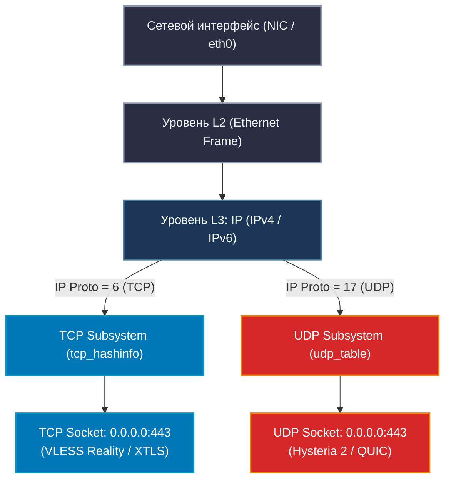
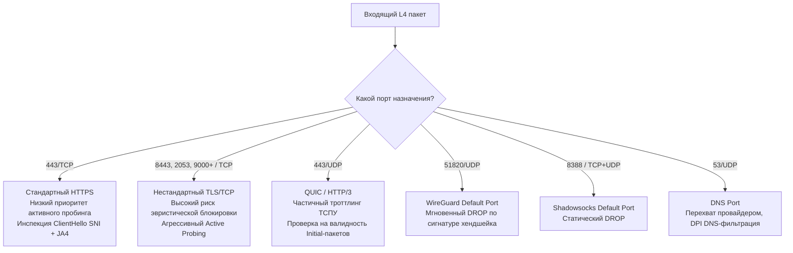
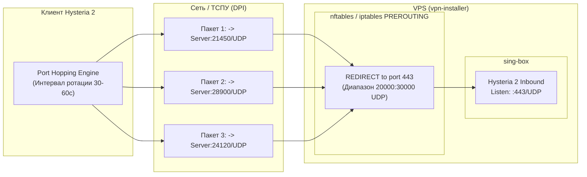
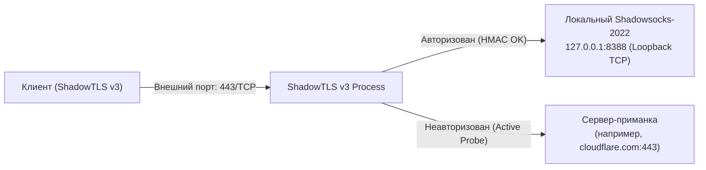
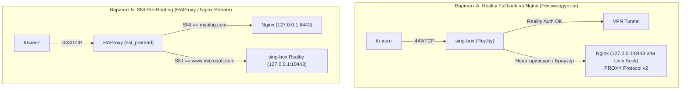
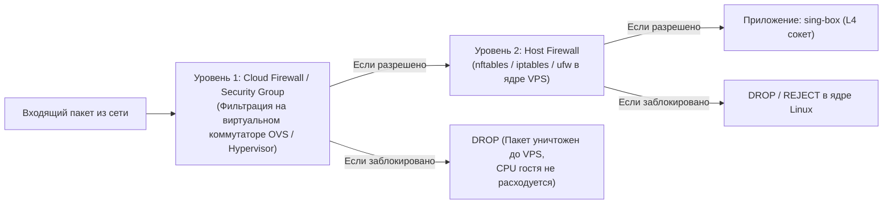

# Сетевые порты для различных стеков, протоколов обхода цензуры и сервисов vpn-installer: матрица портов, мультиплексирование TCP/UDP, конфликты, Port Hopping и правила фаервола

> **Цель исследования:** Разработка исчерпывающего технического справочника по сетевым портам, транспортным протоколам (L4), механизмам мультиплексирования, разрешению порт-конфликтов, динамическому Port Hopping и правилам межсетевого экранирования (Host Firewall & Cloud Security Groups) для построения отказоустойчивого и необнаруживаемого сервера обхода цензуры `vpn-installer` в условиях жесткой фильтрации ТСПУ/РКН (2025–2026 гг.).

---

## Содержание

1. [Введение и фундаментальные принципы транспортного уровня (L4)](#1-введение-и-фундаментальные-принципы-транспортного-уровня-l4)
   - 1.1. Модель сокетов Linux: ортогональность пространств TCP и UDP
   - 1.2. Анатомия 5-tuple и разделение трафика в сетевом стеке ядра
   - 1.3. Специфика цензуры ТСПУ в отношении портов и протоколов
2. [Глубокий анализ портов для ключевых протоколов обхода блокировок](#2-глубокий-анализ-портов-для-ключевых-протоколов-обхода-блокировок)
   - 2.1. VLESS + XTLS Reality (Vision / XHTTP)
   - 2.2. Hysteria 2 (Модифицированный QUIC / UDP) и Port Hopping
   - 2.3. TUIC v5 (Стандартный QUIC / UDP)
   - 2.4. Shadowsocks-2022 (TCP + UDP)
   - 2.5. ShadowTLS v3 (TCP)
   - 2.6. AmneziaWG (AWG 1.0–3.1 / UDP)
   - 2.7. OpenConnect / AnyConnect (ocserv: TCP + UDP)
3. [Мультиплексирование, разделение портов и разрешение конфликтов](#3-мультиплексирование-разделение-портов-и-разрешение-конфликтов)
   - 3.1. Совместное использование порта 443 (VLESS Reality TCP + Hysteria 2 UDP)
   - 3.2. Сосуществование с веб-сервером (Nginx, Caddy, Apache): Reality Fallbacks vs SNI Pre-Routing
   - 3.3. Системные порты управления (SSH, ACME Let's Encrypt, Subscription API)
4. [Взаимодействие с внешними облачными фаерволами (Cloud Security Groups)](#4-взаимодействие-с-внешними-облачными-фаерволами-cloud-security-groups)
   - 4.1. Двухуровневая модель экранирования: Hypervisor vSwitch vs Host Linux Kernel
   - 4.2. Специфика провайдеров (Hetzner, DigitalOcean, AWS, Selectel, Timeweb Cloud)
   - 4.3. Ограничения правил Security Groups и настройка Port Hopping диапазонов
5. [Заблокированные исходящие порты (Outbound Hardening и защита сервера)](#5-заблокированные-исходящие-порты-outbound-hardening-и-защита-сервера)
   - 5.1. Защита от спама и блокировок IP: блокировка SMTP (25, 465, 587 TCP)
   - 5.2. Защита от DMCA: блокировка BitTorrent (порты 6881-6889 и L7-сигнатуры)
   - 5.3. Защита от SSRF и сканирования внутренней сети (RFC 1918, Loopback, Cloud Metadata 169.254.169.254)
   - 5.4. Блокировка протоколов скрытого криптомайнинга (Stratum)
6. [Сводная матрица портов для vpn-installer](#6-сводная-матрица-портов-для-vpn-installer)
   - 6.1. Полная таблица портов и протоколов
   - 6.2. Матрица коллизий и правил совместимости
7. [Готовые эталонные скрипты фаервола](#7-готовые-эталонные-скрипты-фаервола)
   - 7.1. Скрипт nftables (Production-Ready)
   - 7.2. Скрипт iptables-persistent (Классический Linux)
   - 7.3. Скрипт UFW + before.rules (Ubuntu/Debian)
   - 7.4. Фрагмент маршрутизации sing-box (Drop Outbounds)
8. [Библиография, RFC и спецификации](#8-библиография-rfc-и-спецификации)

---

## 1. Введение и фундаментальные принципы транспортного уровня (L4)

### 1.1. Модель сокетов Linux: ортогональность пространств TCP и UDP

Распространенным заблуждением среди начинающих системных администраторов и инженеров является предположение, что сетевой порт (например, `443`) представляет собой единую неделимую сущность, которую может занять только один сервис.

В архитектуре сетевой подсистемы ядра Linux (Network Stack) протоколы **TCP** (IP protocol `6`) и **UDP** (IP protocol `17`) образуют **два полностью изолированных, ортогональных пространства портов**:



В исходном коде ядра Linux сокеты TCP и UDP обслуживаются принципиально разными структурами данных:
1. **TCP:** Сокеты регистрируются в глобальной хэш-таблице `tcp_hashinfo`, которая состоит из раздельных таблиц `listening_hash` (для прослушивающих сокетов в состоянии `LISTEN`) и `ehash` (established hash для активных соединений).
2. **UDP:** Сокеты регистрируются в таблице `udp_table`, содержащей хэш-списки `udp_hslot` по номеру порта.

Вызов системного вызова `bind()`:
- `bind(fd_tcp, {AF_INET, 443, INADDR_ANY})` резервирует порт `443` исключительно в таблице `tcp_hashinfo`.
- `bind(fd_udp, {AF_INET, 443, INADDR_ANY})` резервирует порт `443` исключительно в таблице `udp_table`.

> [!NOTE]
> Системная ошибка `EADDRINUSE` (Address already in use) возникает **только** при попытке привязать второй сокет с одинаковым типом протокола L4 (TCP к TCP или UDP к UDP) к одному и тому же IP-адресу и порту без флага `SO_REUSEPORT`/`SO_REUSEADDR`.
> Таким образом, **порт 443/TCP и порт 443/UDP могут одновременно прослушиваться разными сервисами (или разными инбаундами одного sing-box процесса) на одном VPS без коллизий**.

---

### 1.2. Анатомия 5-tuple и разделение трафика в сетевом стеке ядра

Каждое сетевое соединение однозначно идентифицируется 5-компонентным кортежем (5-tuple):

$$\text{5-Tuple} = \langle \text{Transport Protocol}, \text{Source IP}, \text{Source Port}, \text{Destination IP}, \text{Destination Port} \rangle$$

При поступлении IP-пакета сетевой драйвер и ядро передают его функции `ip_local_deliver_finish()`. Она извлекает заголовок транспортного уровня:
- Если поле `ip_hdr(skb)->protocol == IPPROTO_TCP`, управление передается в `tcp_v4_rcv()`, которая производит поиск сокета в `tcp_hashinfo`.
- Если поле `ip_hdr(skb)->protocol == IPPROTO_UDP`, управление передается в `udp_rcv()`, производящей поиск в `udp_table`.

Это разделение является фундаментальным свойством спецификации RFC 793 (TCP) и RFC 768 (UDP), гарантирующим детерминированную маршрутизацию входящих дейтаграмм на уровне ядра.

---

### 1.3. Специфика цензуры ТСПУ в отношении портов и протоколов

Технические средства противодействия угрозам (ТСПУ) РКН устанавливаются на узлах операторов связи РФ в разрыв каналов связи (Inline) либо через оптические сплиттеры с инжекцией TCP RST / ICMP Unreachable. Алгоритмы классификации трафика ТСПУ используют многоуровневую модель:



1. **Порт 443/TCP — зона максимальной легитимности:**
   Более 90% пользовательского веб-трафика использует порт 443/TCP. Любая неизбирательная эвристическая блокировка на порту 443 несет катастрофический риск *collateral damage* (ложные срабатывания, паралич банковских шлюзов, государственных сервисов, платежных систем, CDN). На порту 443 ТСПУ вынужден действовать точечно: анализировать SNI, проверять соответствие TLS-отпечатков и блокировать конкретные IP-адреса.
2. **Нестандартные порты TCP (8443, 2053, 2083, 2087, 8080 и др.):**
   При обнаружении зашифрованного TLS-трафика на нестандартных портах эвристические анализаторы ТСПУ присваивают сессии повышенный скор подозрительности. На многих провайдерах (особенно мобильных операторах «большой четверки») TLS на нестандартных портах подвергается безусловному троттлингу или RST-инжекции после передачи 5–10 пакетов данных.
3. **Стандартные VPN-порты (51820/UDP, 1194/UDP, 500/4500 UDP):**
   Начиная с августа 2023 года ТСПУ активировал сигнатурно-портовые фильтры: трафик на порт `51820/UDP` (WireGuard) блокируется практически на 100% магистралей РФ в течение 1–3 секунд после отправки первого `Type 1 Initiation Packet`. Трафик OpenVPN (`1194/UDP`, `1194/TCP`) детектируется по сигнатуре `opcode` в первом байте пакета.
4. **Троттлинг и деградация UDP / QUIC:**
   Периодические кампании ТСПУ (блокировки YouTube, тесты суверенного интернета) сопровождаются искусственным занижением полосы пропускания UDP-трафика до 64–128 Кбит/с либо дропом сессий, превышающих лимит по пакетам на одном `(src_ip, src_port, dst_ip, dst_port)`. Это делает механизм **Port Hopping** критически важным для QUIC-протоколов (Hysteria 2).

---

## 2. Глубокий анализ портов для ключевых протоколов обхода блокировок

### 2.1. VLESS + XTLS Reality (Vision / XHTTP)

#### Порт прослушивания (Inbound Listen Port): 443/TCP
- **Почему строго 443/TCP:**
  Технология Reality основана на концепции *SNI-stealing* — заимствовании чужого криптографического сертификата без владения приватным ключом. Клиент отправляет ClientHello с легитимным внешним доменом (например, `www.microsoft.com`).
  Если VLESS Reality размещен на порту `8443/TCP`, то соединение клиента выглядит для ТСПУ аномалией: клиент обращается к `www.microsoft.com` по порту `8443`. В реальном интернете Microsoft, Google и Apple не обслуживают свои основные веб-порталы на порту 8443. Сканирующие системы РКН и пассивный DPI сразу классифицируют такой трафик как прокси-туннель.
- **Поведение при активном пробинге (Active Probing):**
  Когда автоматический зонд ТСПУ выполняет проверочное подключение к серверу на порт `443/TCP` (без знания Reality `shortId` или приватного ключа), ядро sing-box/Xray прозрачно перенаправляет этот TCP-поток на целевой сервер-приманку (`dest`). Зонд видит полностью валидный TLS-хендшейк оригинального сервера Microsoft, получает его легитимный сертификат и считает хост обычным веб-сервером.

#### Порт назначения (Outbound Dest Port): 443 целевого хоста
- В конфигурации Reality поле `dest` задается как `www.microsoft.com:443` или `dl.google.com:443`.
- **Механизм Fallback / Handshake Relay:**
  ```mermaid
  sequenceDiagram
      autonumber
      participant Scanner as Зонд ТСПУ (Active Probe)
      participant Client as Легитимный клиент VLESS
      participant SingBox as vpn-installer (sing-box:443)
      participant RealSite as www.microsoft.com:443

      Note over Scanner,SingBox: Неавторизованный запрос
      Scanner->>SingBox: TLS ClientHello (без shortId)
      SingBox->>RealSite: TCP Handshake Relay (:443)
      RealSite-->>SingBox: TLS ServerHello + Certificate
      SingBox-->>Scanner: Прозрачный проброс ответа Microsoft
      Note over Scanner: Зонд подтверждает: это легитимный Microsoft!

      Note over Client,SingBox: Авторизованный запрос
      Client->>SingBox: TLS ClientHello (Reality Auth + shortId)
      SingBox-->>Client: XTLS Reality Tunnel Established
      Client->>SingBox: Зашифрованный трафик VLESS-Vision
  ```
  Использование целевого порта `443` на стороне маскировочного сайта критично: если указать иной порт, то во время fallback-проксирования удаленный сервер разорвет сессию, что выдаст присутствие прокси-шлюза.

---

### 2.2. Hysteria 2 (Модифицированный QUIC / UDP) и Port Hopping

#### Базовый порт прослушивания: 443/UDP
- **Обоснование:**
  Порт `443/UDP` — это стандартный порт спецификации HTTP/3 и протокола QUIC (RFC 9000, RFC 9114). Большинство современных браузеров (Chrome, Safari, Firefox) используют `443/UDP` для обмена данными с серверами Cloudflare, Google, Meta и CDN.
- **Работа совместно с VLESS Reality:**
  Благодаря ортогональности сокетов ядра Linux, `sing-box` открывает:
  - `AF_INET, SOCK_STREAM` на `0.0.0.0:443` (VLESS Reality).
  - `AF_INET, SOCK_DGRAM` на `0.0.0.0:443` (Hysteria 2).
  Оба сервиса делят порт 443 одновременно без взаимных помех.

#### Альтернативные базовые порты (Fallback Ports)
- **Порты:** `8443/UDP`, `9443/UDP`, `4433/UDP`.
- **Когда использовать:** В периоды масштабных учений РКН, когда операторы связи временно включают жесткий шейпинг всего UDP-трафика на порту `443` (для замедления YouTube). На некоторых провайдерах нестандартные порты UDP могут не попадать под фильтры QUIC-троттлинга.

#### Технология Port Hopping (Динамическая ротация портов UDP)

##### Принцип действия
ТСПУ ведет учет сессий (Session Tracking). Когда он видит непрерывную передачу UDP-пакетов между IP клиента и IP сервера на фиксированный порт со скоростью 50–100 Мбит/с, включается эвристический троттлинг.
При включении Port Hopping клиент Hysteria 2 каждые $N$ секунд или при переподключении меняет внешний порт назначения, отправляя дейтаграммы на случайный порт из согласованного пула (например, `25432/UDP`, `29810/UDP` и т.д.).
На сервере все дейтаграммы из этого пула перенаправляются правилом фаервола на базовый локальный порт Hysteria 2 (`443/UDP`).



##### Выбор безопасного диапазона портов и конфликт с Ephemeral Ports ядра
Стандарт IANA (RFC 6335) делит диапазон портов `0-65535` на три категории:
1. **Системные (Well-Known):** `0–1023`.
2. **Зарегистрированные (User/Registered):** `1024–49151`.
3. **Динамические/Эфемеридные (Dynamic/Private/Ephemeral):** `49152–65535`.

В дистрибутивах Linux (Ubuntu, Debian) диапазон локальных исходящих портов ядра настраивается через параметр sysctl `net.ipv4.ip_local_port_range`. По умолчанию в большинстве современных дистрибутивов он равен:
```text
cat /proc/sys/net/ipv4/ip_local_port_range
32768   60999
```

> [!CAUTION]
> **Критический архитектурный риск коллизий портов:**
> Если назначить пул Port Hopping как `10000:60000/UDP` или `20000:50000/UDP`, этот диапазон пересекается с эфемеридными портами ядра (`32768:60999`).
> Когда процесс на сервере (например, сам `sing-box`, Nginx или фоновый curl) устанавливает исходящее UDP-соединение к DNS-серверу (`8.8.8.8:53`) или API, ядро выделяет локальный порт из диапазона `32768:60999`.
> Правило `iptables REDIRECT` срабатывает в цепочке `PREROUTING`. Это означает:
> 1. Если входящий пакет от клиента Hysteria 2 имеет целевой порт из пула, он безусловно перенаправляется на локальный порт `443`.
> 2. Если локальный сервис ожидает ответный пакет от внешнего сервера на свой эфемеридный порт, который случайно попал в диапазон REDIRECT, входящий ответ может быть перехвачен и ошибочно доставлен сокету Hysteria 2, ломая соединение системного процесса!

**Инженерное решение для `vpn-installer`:**
Рекомендуется использовать строго выделенный диапазон в зоне зарегистрированных портов IANA ниже диапазона Linux Ephemeral Ports:
$$\text{Рекомендуемый пул Port Hopping:} \quad \mathbf{20000:30000/UDP}$$
- Преимущество 1: Пул размером 10 001 порт абсолютно достаточен для эффективного обхода троттлинга ТСПУ.
- Преимущество 2: Не пересекается со стандартным `ip_local_port_range` (`32768:60999`).
- Преимущество 3: Не затрагивает системные порты (`0-1023`) и стандартные порты баз данных/прокси (`1024-9999`).

---

### 2.3. TUIC v5 (QUIC / UDP)

#### Рекомендуемые порты: 8443/UDP, 9443/UDP
- **Архитектура:** TUIC v5 построен на базе стандартного протокола QUIC (библиотека `quinn` на Rust или `quic-go` в sing-box).
- **Конфликт с Hysteria 2:**
  Поскольку и Hysteria 2, и TUIC v5 работают поверх UDP, они **не могут слушать один и тот же порт 443/UDP на одном IP-адресе**.
  Попытка указать в `sing-box` два разных inbounds (`hysteria2` и `tuic`) с одинаковым `server_port: 443` приведет к ошибке:
  `fatal error: start inbounds: bind: address already in use`.

**Рекомендуемая схема распределения UDP-портов:**
- `443/UDP` $\to$ **Hysteria 2** (как основной высокоскоростной протокол с Brutal CC и Port Hopping).
- `8443/UDP` (или `9443/UDP`) $\to$ **TUIC v5** (как резервный транспорт с минимальным RTT).

---

### 2.4. Shadowsocks-2022

#### Традиционный порт: 8388 / TCP + UDP
- Исторически порт `8388` является стандартным портом оригинального Shadowsocks.
- **Статус на ТСПУ в РФ:**
  **КАТЕГОРИЧЕСКИ НЕ РЕКОМЕНДУЕТСЯ К ИСПОЛЬЗОВАНИЮ.**
  Порт `8388` внесен в статические списки подозрительных портов на ТСПУ. Любой незашифрованный или псевдослучайный поток данных на порту 8388 вызывает мгновенный сброс сессии (TCP RST) или blackhole.

#### Альтернативные порты для Shadowsocks-2022
- **Рекомендуемый диапазон:** Случайный порт в диапазоне `9000–9999` или `31000–32000` (TCP + UDP).
- **Специфика детекции ТСПУ:**
  Shadowsocks-2022 устранил уязвимости активного пробинга старых версий (AEAD-2022 использует фиксированные заголовки с меткой времени, replay-кэш и отдельный ключ для заголовка). Однако на L4-уровне пакеты Shadowsocks представляют собой чистый поток с высокой энтропией Шеннона ($H \approx 8.0$), лишенный сигнатур открытого текста.
  ТСПУ применяет энтропийные классификаторы: неизвестный протокол с максимальной энтропией на произвольном порту глушится через 5–20 МБ переданных данных. Поэтому голый Shadowsocks-2022 в РФ должен использоваться либо внутри РФ (между VPS), либо в связке с обфускатором (ShadowTLS v3).

---

### 2.5. ShadowTLS v3

#### Архитектура портов и перенаправления
ShadowTLS имитирует легитимный TLS-хендшейк, перехватывая первые пакеты клиента и проверяя их HMAC-подпись.



- **Внешний порт:** `443/TCP` (или `8443/TCP`).
- **Внутренний порт проксирования:** `127.0.0.1:8388` (прослушивается локальным демоном Shadowsocks-2022).
- **Конфликт с Reality:** И ShadowTLS v3, и VLESS Reality требуют прямого прослушивания порта `443/TCP`. На одном IP-адресе они не могут работать одновременно без сложной схемы пре-роутинга SNI (см. раздел 3.2).

---

### 2.6. AmneziaWG (AWG 1.0–3.1)

#### Проблема стандартного порта WireGuard (51820/UDP)
Оригинальный протокол WireGuard имеет жестко фиксированную структуру первого пакета (`Type 1: Initiation`, длина ровно 148 байт, фиксированные смещения полей). ТСПУ полностью блокирует порт `51820/UDP` и сигнатуру WireGuard на любых портах.

#### Подбор портов для AmneziaWG
AmneziaWG рандомизирует заголовки (параметры $H_1, H_2, H_3, H_4$) и добавляет мусорные пакеты пре-хендшейка ($J_c, J_{min}, J_{max}$), делая трафик неотличимым от случайного UDP.

| Порт AWG | Оценка безопасности | Преимущества | Недостатки и риски |
| :--- | :--- | :--- | :--- |
| **Случайный высокий порт (`40000–55000/UDP`)** | **Рекомендуется (Оптимально)** | Нет конфликтов с веб-службами; чистая история портов | Некоторый риск троттлинга провайдером нестандартных UDP-сессий |
| **Маскировка под DNS (`53/UDP`)** | **Высокий риск** | Порт 53 открыт везде, не блокируется простыми файрволами | **Перехват провайдером:** многие операторы РФ перенаправляют весь UDP 53 на свои локальные DNS-резолверы через NAT/DPI. Не-DNS пакеты вызывают ошибку парсинга и сбрасываются |
| **Маскировка под NTP (`123/UDP`)** | **Средний риск** | Не вызывает подозрений в фаерволах | Фиксированный размер NTP пакетов (48 байт); пакеты AWG большего размера вызовут подозрение L7 DPI |
| **Маскировка под QUIC (`443/UDP`)** | **Ограниченно** | Высший приоритет доверия UDP | Жесткий конфликт с Hysteria 2 на одном сервере |

---

### 2.7. OpenConnect / AnyConnect (ocserv)

#### Архитектура портов ocserv
Протокол Cisco AnyConnect / OpenConnect разделяет трафик на два независимых канала:
1. **Control Channel (Аутентификация и управление):** `443/TCP` (стандартный TLS-хендшейк, XML-интерфейс).
2. **Data Channel (Передача данных туннеля):** `443/UDP` (протокол DTLS 1.2 / DTLS 1.3 для минимизации задержек).

> [!WARNING]
> Сервер `ocserv` по умолчанию претендует одновременно на `443/TCP` **и** `443/UDP`.
> Это создает **100% аппаратный конфликт** с базовой связкой `VLESS Reality` (443/TCP) + `Hysteria 2` (443/UDP).
> Если развертывание OpenConnect необходимо, его следует переносить на альтернативную пару портов: например, `8443/TCP` + `8443/UDP`.

---

## 3. Мультиплексирование, разделение портов и разрешение конфликтов

### 3.1. Совместное использование порта 443 (VLESS Reality TCP + Hysteria 2 UDP)

Благодаря архитектуре сетевого стека Linux, `sing-box` позволяет декларативно описать одновременную работу обоих протоколов на порту 443 в едином конфигурационном файле.

```json
{
  "log": {
    "level": "warn",
    "timestamp": true
  },
  "inbounds": [
    {
      "type": "vless",
      "tag": "vless-reality-in",
      "listen": "::",
      "listen_port": 443,
      "tcp_fast_open": true,
      "users": [
        {
          "uuid": "a7b3c4d5-e6f7-48a9-b0c1-d2e3f4a5b6c7",
          "flow": "xtls-rprx-vision"
        }
      ],
      "tls": {
        "enabled": true,
        "server_name": "www.microsoft.com",
        "reality": {
          "enabled": true,
          "handshake": {
            "server": "www.microsoft.com",
            "server_port": 443
          },
          "private_key": "YOUR_REALITY_PRIVATE_KEY",
          "short_id": ["0123456789abcdef"]
        }
      }
    },
    {
      "type": "hysteria2",
      "tag": "hysteria2-in",
      "listen": "::",
      "listen_port": 443,
      "users": [
        {
          "password": "YOUR_STRONG_HYSTERIA2_PASSWORD"
        }
      ],
      "ignore_client_bandwidth": false,
      "tls": {
        "enabled": true,
        "certificate_path": "/etc/sing-box/certs/cert.pem",
        "key_path": "/etc/sing-box/certs/key.pem"
      },
      "masquerade": "https://www.microsoft.com"
    }
  ]
}
```

- Входящие TCP-сегменты на порт 443 обрабатываются инбаундом `vless-reality-in`.
- Входящие UDP-дейтаграммы на порт 443 обрабатываются инбаундом `hysteria2-in`.
- Коллизии на уровне сокетов ядра отсутствуют.

---

### 3.2. Сосуществование с веб-сервером (Nginx, Caddy, Apache)

Если на том же VPS требуется поддерживать рабочий веб-сайт (например, корпоративный портал, блог или API), возникает конфликт за порт `443/TCP`. Существует три архитектурных решения:



#### Вариант А: Reality Fallback на локальный Nginx (Наиболее скрытный)
`sing-box` занимает порт `443/TCP`. Все подключения, не прошедшие проверку Reality-ключа (обычные браузеры, сканеры поисковиков, зонды РКН), прозрачно пересылаются на локальный веб-сервер через fallbacks.

```json
"reality": {
  "enabled": true,
  "handshake": {
    "server": "127.0.0.1",
    "server_port": 8443
  },
  "private_key": "...",
  "short_id": ["..."]
}
```
*Настройка Nginx:*
Nginx переводится на прослушивание `127.0.0.1:8443`.
Для сохранения реальных IP-адресов посетителей сайта используется директива `proxy_protocol` (при поддержке PROXY protocol ядром sing-box).

#### Вариант Б: SNI Pre-routing через HAProxy / Nginx Stream (`ssl_preread`)
Фронтендом выступает HAProxy на порту `443/TCP`. Он считывает Server Name Indication (SNI) из открытого первого пакета TLS ClientHello без расшифровки сессии:
- Если `req_ssl_sni -i mydomain.com` $\to$ перенаправить на Nginx (`127.0.0.1:8443`).
- Если `req_ssl_sni -i www.microsoft.com` $\to$ перенаправить на sing-box Reality (`127.0.0.1:10443`).

*Конфигурация HAProxy (`/etc/haproxy/haproxy.cfg`):*
```haproxy
frontend tls_in
    bind :443
    mode tcp
    tcp-request inspect-delay 5s
    tcp-request content accept if { req_ssl_hello_type 1 }

    use_backend bk_reality if { req_ssl_sni -i www.microsoft.com }
    default_backend bk_web

backend bk_reality
    mode tcp
    server srv_reality 127.0.0.1:10443 check

backend bk_web
    mode tcp
    server srv_nginx 127.0.0.1:8443 check send-proxy-v2
```

---

### 3.3. Системные порты управления

#### 1. Порт SSH (Secure Shell)
- **Стандартный порт:** `22/TCP`.
- **Риски:** Постоянное сканирование китайскими и российскими ботнетами, генерация мусорного трафика в журнале `auth.log`, попытки подбора паролей.
- **Рекомендация для `vpn-installer`:** Перенос SSH на нестандартный порт в зоне зарегистрированных портов, например `2222/TCP` или `22022/TCP`. Вход строго по ключам (Ed25519), отключение аутентификации по паролю (`PasswordAuthentication no`).

#### 2. Порт 80/TCP (ACME Let's Encrypt HTTP-01 Challenge)
- Сертификат Let's Encrypt необходим для работы Hysteria 2 / TUIC (если не используется самоподписанный сертификат с Salamander-обфускацией).
- Проверка владения доменом по методу **HTTP-01** требует прослушивания порта `80/TCP`.
- **Рекомендация:**
  - Открывать порт `80/TCP` в фаерволе.
  - Использовать встроенный ACME-клиент sing-box, либо утилиту `certbot / acme.sh` в режиме standalone.
  - Альтернатива без открытия порта 80: **DNS-01 Challenge** (выпуск сертификата через API Cloudflare/DNS-провайдера). В этом случае порт `80/TCP` можно полностью закрыть в фаерволе!

#### 3. Порт Subscription API (Сервис подписок)
- Для импорта настроек в клиенты v2rayN, Sing-box, Hiddify, Streisand требуется HTTP(S) эндпоинт подписки.
- **Порты:** Локальный порт сервиса `8080/TCP` или `9090/TCP`.
- **Требования безопасности:**
  - Эндпоинт ни в коем случае не должен быть открыт в публичный интернет без авторизации.
  - Доступ к подписке защищается длинным случайным токеном: `/sub/d41d8cd98f00b204e9800998ecf8427e`.
  - Рекомендуется проксировать сервис подписок через локальный Nginx/Caddy с TLS-шифрованием, либо раздавать по статическому файловому эндпоинту.

---

## 4. Взаимодействие с внешними облачными фаерволами (Cloud Security Groups)

### 4.1. Двухуровневая модель экранирования: Hypervisor vSwitch vs Host Linux Kernel

При работе в публичных облаках пакет проходит через два последовательных рубежа фильтрации:



> [!IMPORTANT]
> Если порт закрыт в панели управления облачного провайдера (Cloud Security Group), пакет отбрасывается аппаратным шлюзом или гипервизором хостинга. Пакет **физически не поступает на виртуальный сетевой интерфейс `eth0`**, и локальные утилиты `tcpdump` на VPS его не увидят.

---

### 4.2. Специфика провайдеров и настройка Port Hopping диапазонов

| Провайдер | Механизм фаервола | Поддержка Port Ranges | Ограничения и особенности |
| :--- | :--- | :--- | :--- |
| **Hetzner Cloud** | Hetzner Cloud Firewall | **Да** (формат: `20000-30000`) | Лимит: не более 50 правил на инстанс. Бесплатно. Работает мгновенно. |
| **DigitalOcean** | DO Cloud Firewalls | **Да** (формат: `20000-30000`) | Привязка по тегам дроплетов. Лимит правил: 50 входящих / 50 исходящих. |
| **AWS EC2** | Security Groups (VPC) | **Да** (формат: `20000-30000`) | Stateful-фильтрация. Лимит: 60 правил на SG по умолчанию. |
| **Selectel (VPC)** | Security Groups (OpenStack Neutron) | **Да** (формат: `20000:30000`) | В базовых виртуальных серверах (без VPC) внешний фаервол отсутствует (все порты открыты по умолчанию). |
| **Timeweb Cloud** | Сетевой экран панели | **Да** (диапазоны портов) | Простой веб-интерфейс, поддержка списков портов через запятую и диапазонов через дефис. |

---

### 4.3. Ограничения правил Security Groups и настройка Port Hopping диапазонов

Некоторые неопытные пользователи пытаются добавить каждый порт для Port Hopping отдельным правилом, упираясь в жесткий лимит облака (обычно 50–60 правил на сервер).

**Правило конфигурирования Security Group для `vpn-installer`:**
Всегда указывать диапазон портов единой записью (Range):
- **Protocol:** `UDP`
- **Port Range:** `20000-30000` (для Hetzner/AWS) или `20000:30000` (для OpenStack)
- **Source:** `0.0.0.0/0` (IPv4) и `::/0` (IPv6)

Если провайдер не предоставляет внешний фаервол (например, некоторые KVM-лоукостеры), вся нагрузка по фильтрации ложится на локальный `nftables` хоста.

---

## 5. Заблокированные исходящие порты (Outbound Hardening и защита сервера)

Любой публичный прокси-сервер может стать объектом злоупотреблений (Abuse) со стороны ботов, вредоносного ПО на устройствах клиентов или неосторожных пользователей. Это ведет к жалобам в дата-центр, попаданию IP в спам-базы (Spamhaus, SURBL) и мгновенной блокировке сервера хостером без возврата средств.

### 5.1. Защита от спама и блокировок IP: блокировка SMTP

Практически все международные дата-центры (Hetzner, OVH, DigitalOcean, Linode) запрещают неавторизованную рассылку почты.
Сервер `vpn-installer` должен намертво блокировать любые исходящие попытки подключения к SMTP-портам:
- `25/TCP` — Классический незашифрованный SMTP (главный вектор спама).
- `465/TCP` — SMTPS (SMTP over TLS).
- `587/TCP` — Submission (SMTP с обязательным STARTTLS).
- `2525/TCP` — Альтернативный порт SMTP Submission.

*Блокировка должна осуществляться как в ядре (`nftables/iptables`), так и на уровне логики маршрутизации `sing-box`.*

---

### 5.2. Защита от DMCA: блокировка BitTorrent

Передача BitTorrent-трафика через зарубежный VPS гарантированно генерирует жалобы от мониторинговых агентств правообладателей (DMCA Abuse Notice). В Германии (Hetzner) или США такие жалобы приводят к автоматическому отключению сервера в течение 24 часов.

Механизм защиты состоит из двух рубежей:
1. **L4 Фильтрация портов:**
   - Блокировка стандартных портов входящих/исходящих пиров BitTorrent: `6881–6889 / TCP+UDP`.
   - Блокировка стандартного порта BitTorrent DHT (Distributed Hash Table): `6881/UDP`.
2. **L7 Инспекция трафика в sing-box (Sniffing):**
   Поскольку современные торрент-клиенты используют случайные порты и шифрование протокола (BitTorrent Protocol Encryption / MSE), блокировки портов 6881-6889 недостаточно.
   В `sing-box` активируется модуль `sniff` и правило отбрасывания по протоколу:
   `"protocol": "bittorrent" -> "action": "reject"`.

---

### 5.3. Защита от SSRF и сканирования внутренней сети

Если клиент VPN получает доступ к серверу, он потенциально может попытаться просканировать внутреннюю инфраструктуру хостинга.

Обязательно блокируются исходящие подключения к:
1. **Cloud Metadata IP (`169.254.169.254`):**
   В AWS, DigitalOcean, Hetzner, GCP по этому служебному Link-Local адресу доступен Metadata API, через который можно извлечь токены авторизации инстанса, IAM-роли и SSH-ключи.
2. **Приватные диапазоны по RFC 1918:**
   `10.0.0.0/8`, `172.16.0.0/12`, `192.168.0.0/16`.
3. **Loopback интерфейс хоста:**
   `127.0.0.0/8` (IPv4) и `::1/128` (IPv6), чтобы защитить локальные порты Redis, Docker API (`2375`), локальные БД.

---

### 5.4. Блокировка протоколов скрытого криптомайнинга (Stratum)

Вредоносное ПО, случайно попавшее на клиентское устройство, может использовать VPN-канал для подключения к майнинг-пулам криптовалют (Monero, Bitcoin), что влечет за собой жалобы на аномальный трафик:
- Порты протокола Stratum: `3333/TCP`, `4444/TCP`, `8333/TCP`, `14444/TCP`.

---

## 6. Сводная матрица портов для vpn-installer

### 6.1. Полная таблица портов и протоколов

| Порт | L4 Протокол | Направление | Сервис / Назначение | Обязательность | Риск детекции ТСПУ | Рекомендация по фаерволу |
| :---: | :---: | :---: | :--- | :---: | :---: | :--- |
| **443** | **TCP** | **IN** | **VLESS + XTLS Reality (Vision / XHTTP)** | **Критически обязателен** | **Минимальный** (маскировка под легитимный TLS) | Открыть в Cloud SG и Host Firewall для `0.0.0.0/0` и `::/0` |
| **443** | **UDP** | **IN** | **Hysteria 2 (Базовый порт QUIC)** | **Критически обязателен** | **Средний** (возможен общий троттлинг QUIC) | Открыть в Cloud SG и Host Firewall для `0.0.0.0/0` и `::/0` |
| **20000–30000** | **UDP** | **IN** | **Hysteria 2 Port Hopping (Диапазон ротации)** | **Рекомендуется** | **Минимальный** (устраняет сессионный троттлинг) | Открыть **диапазон** в Cloud SG; в Host FW настроить REDIRECT на `443/UDP` |
| **8443** | **UDP** | **IN** | **TUIC v5 (Альтернативный QUIC-транспорт)** | Опционально | Средний (нестандартный UDP) | Открыть, если развернут TUIC v5 |
| **9000–9999** *(случайный)* | **TCP+UDP** | **IN** | **Shadowsocks-2022 (Случайный порт)** | Опционально | Высокий (при прямом доступе без обфускации) | Открыть только выбранный порт; исключить порт 8388 |
| **40000–55000** *(случайный)* | **UDP** | **IN** | **AmneziaWG (AWG 1.0–3.1 обфусцированный WireGuard)** | Опционально | Минимальный (при корректных $H_1-H_4, J$) | Открыть только выбранный случайный порт; исключить 51820 |
| **2222** *(кастомный)* | **TCP** | **IN** | **SSH Management (Управление сервером)** | **Обязателен** | Нулевой (администрирование) | Открыть для администратора (желательно ограничить по доверенным IP) |
| **80** | **TCP** | **IN** | **ACME Let's Encrypt (HTTP-01 Challenge)** | Условно | Нулевой | Открывать при получении сертификата; закрыть, если используется DNS-01 |
| **8080** | **TCP** | **LOCAL** | **Subscription API (Выдача конфигураций)** | Рекомендуется | — | **ЗАКРЫТЬ снаружи!** Проксировать через Nginx с TLS/аутентификацией |
| **25, 465, 587, 2525** | **TCP** | **OUT** | **SMTP Mail Submission (Почтовый спам)** | **ЗАПРЕЩЕН** | — | **Безусловный DROP/REJECT** в Outbound правилах |
| **6881–6889** | **TCP+UDP** | **OUT** | **BitTorrent Peers & DHT** | **ЗАПРЕЩЕН** | — | **Безусловный DROP** в Outbound правилах |
| **3333, 4444, 8333** | **TCP** | **OUT** | **Stratum Mining Pools** | **ЗАПРЕЩЕН** | — | **Безусловный DROP** в Outbound правилах |
| **169.254.169.254** | **ALL** | **OUT** | **Cloud Instance Metadata Service** | **ЗАПРЕЩЕН** | — | **Безусловный DROP** в Outbound правилах |

---

### 6.2. Матрица коллизий и правил совместимости

| Сервис А | Сервис Б | Конфликтный порт | Решение коллизии |
| :--- | :--- | :---: | :--- |
| **VLESS Reality** | **Hysteria 2** | `443` | **Конфликта нет!** Reality слушает `443/TCP`, Hysteria 2 слушает `443/UDP`. |
| **Hysteria 2** | **TUIC v5** | `443/UDP` | **Конфликт.** Разделение: Hysteria 2 на `443/UDP`, TUIC v5 на `8443/UDP`. |
| **VLESS Reality** | **Nginx / Caddy** | `443/TCP` | **Конфликт.** Решение 1: Reality слушает 443, fallback на Nginx (`127.0.0.1:8443`). Решение 2: HAProxy со `ssl_preread`. |
| **VLESS Reality** | **ShadowTLS v3** | `443/TCP` | **Конфликт.** Разделение: Reality на `443/TCP`, ShadowTLS на `8443/TCP`. |
| **Hysteria 2** | **AmneziaWG** | `443/UDP` | **Конфликт** (если AWG маскируется под 443). Разделение: AWG выносится на случайный порт (например, `48291/UDP`). |
| **VLESS Reality** | **OpenConnect (ocserv)** | `443/TCP` | **Конфликт.** Перенос ocserv на кастомный порт (например, `8443/TCP + 8443/UDP`). |

---

## 7. Готовые эталонные скрипты фаервола

### 7.1. Скрипт nftables (Production-Ready)

Фреймворк `nftables` является современным стандартным пакетным фильтром ядра Linux, заменившим устаревший `iptables`. Он обеспечивает минимальный оверхед по CPU и атомарную загрузку правил.

Сохраните в файл `/etc/nftables.conf`:

```nftables
#!/usr/sbin/nft -f

flush ruleset

table inet filter {
    # Множество портов, запрещенных для исходящего трафика (Spam / Abuse)
    set blocked_out_tcp {
        type inet_service
        elements = { 25, 465, 587, 2525, 3333, 4444, 6881-6889, 8333 }
    }

    set blocked_out_udp {
        type inet_service
        elements = { 6881-6889 }
    }

    chain input {
        type filter hook input priority filter; policy drop;

        # 1. Разрешить установленные и связанные соединения (Stateful)
        ct state established,related accept

        # 2. Дропать невалидные пакеты
        ct state invalid drop

        # 3. Разрешить локальный трафик (Loopback)
        iif "lo" accept

        # 4. Разрешить служебный ICMP / ICMPv6 (Ping, Path MTU Discovery)
        ip protocol icmp accept
        ip6 nexthdr ipv6-icmp accept

        # 5. Управление: SSH (порт 2222)
        tcp dport 2222 accept

        # 6. Web / ACME Let's Encrypt: порт 80
        tcp dport 80 accept

        # 7. VLESS Reality: порт 443/TCP
        tcp dport 443 accept

        # 8. Hysteria 2: базовый порт 443/UDP
        udp dport 443 accept

        # 9. TUIC v5: порт 8443/UDP
        udp dport 8443 accept

        # 10. AmneziaWG: случайный порт (пример: 48291/UDP)
        udp dport 48291 accept

        # 11. Hysteria 2 Port Hopping: разрешаем входящие дейтаграммы пула
        udp dport 20000-30000 accept

        # Логирование и сброс остальных входящих пакетов (rate-limited)
        limit rate 5/minute burst 10 packets log prefix "[NFT-INPUT-DROP]: "
        drop
    }

    chain forward {
        type filter hook forward priority filter; policy drop;
        
        # Разрешить пересылку установленных сессий (для TUN / VPN-интерфейсов)
        ct state established,related accept
        iifname "sing-tun*" accept
        iifname "awg*" accept
    }

    chain output {
        type filter hook output priority filter; policy accept;

        # Защита от SSRF: блокировка доступа к Cloud Instance Metadata
        ip daddr 169.254.169.254 drop

        # Outbound Hardening: Блокировка исходящего спама (SMTP) и майнинга
        tcp dport @blocked_out_tcp drop
        udp dport @blocked_out_udp drop
    }
}

table ip nat {
    chain prerouting {
        type nat hook prerouting priority dstnat; policy accept;

        # Hysteria 2 Port Hopping: перенаправление пула 20000:30000 UDP на локальный сокет 443
        iifname != "lo" udp dport 20000-30000 redirect to :443
    }

    chain postrouting {
        type nat hook postrouting priority srcnat; policy accept;

        # Маскарадинг для исходящего трафика VPN-клиентов
        oifname != "lo" masquerade
    }
}
```

Активация и проверка:
```bash
chmod 644 /etc/nftables.conf
nft -c -f /etc/nftables.conf   # Проверка синтаксиса
systemctl enable --now nftables
systemctl restart nftables
nft list ruleset              # Проверка загруженных правил
```

---

### 7.2. Скрипт iptables-persistent (Классический Linux)

Для серверов, использующих традиционную подсистему `iptables`:

```bash
#!/usr/bin/env bash
set -euo pipefail

echo "[+] Очистка существующих правил iptables..."
iptables -F
iptables -X
iptables -t nat -F
iptables -t nat -X
iptables -t mangle -F
iptables -t mangle -X

# Базовые политики: блокировать входящие и транзитные пакеты
iptables -P INPUT DROP
iptables -P FORWARD DROP
iptables -P OUTPUT ACCEPT

echo "[+] Настройка цепочки INPUT..."
# Разрешить loopback
iptables -A INPUT -i lo -j ACCEPT

# Разрешить established/related
iptables -A INPUT -m conntrack --ctstate ESTABLISHED,RELATED -j ACCEPT
iptables -A INPUT -m conntrack --ctstate INVALID -j DROP

# ICMP (Ping и Path MTU Discovery)
iptables -A INPUT -p icmp -j ACCEPT

# Системные порты: SSH (2222) и ACME (80)
iptables -A INPUT -p tcp --dport 2222 -j ACCEPT
iptables -A INPUT -p tcp --dport 80 -j ACCEPT

# Inbound VLESS Reality: 443/TCP
iptables -A INPUT -p tcp --dport 443 -j ACCEPT

# Inbound Hysteria 2: 443/UDP
iptables -A INPUT -p udp --dport 443 -j ACCEPT

# Inbound TUIC v5: 8443/UDP
iptables -A INPUT -p udp --dport 8443 -j ACCEPT

# Inbound AmneziaWG: 48291/UDP
iptables -A INPUT -p udp --dport 48291 -j ACCEPT

# Inbound Hysteria 2 Port Hopping Range: 20000-30000/UDP
iptables -A INPUT -p udp --dport 20000:30000 -j ACCEPT

echo "[+] Настройка NAT (Port Hopping)..."
# Перенаправление диапазона портов на 443/UDP
iptables -t nat -A PREROUTING -p udp --dport 20000:30000 -j REDIRECT --to-ports 443

echo "[+] Настройка Outbound Hardening..."
# Блокировка Cloud Metadata (SSRF)
iptables -A OUTPUT -d 169.254.169.254 -j DROP

# Блокировка исходящего спама (SMTP)
iptables -A OUTPUT -p tcp -m multiport --dports 25,465,587,2525 -j DROP

# Блокировка BitTorrent портов
iptables -A OUTPUT -p tcp -m multiport --dports 6881:6889 -j DROP
iptables -A OUTPUT -p udp -m multiport --dports 6881:6889 -j DROP

# Блокировка майнинга Stratum
iptables -A OUTPUT -p tcp -m multiport --dports 3333,4444,8333 -j DROP

echo "[+] Сохранение правил iptables..."
if command -v netfilter-persistent &>/dev/null; then
    netfilter-persistent save
elif command -v iptables-save &>/dev/null; then
    mkdir -p /etc/iptables
    iptables-save > /etc/iptables/rules.v4
fi

echo "[✓] Конфигурация iptables успешно применена!"
```

---

### 7.3. Скрипт UFW + before.rules (Ubuntu/Debian)

Если администратор предпочитает утилиту `ufw`, правила NAT для Port Hopping добавляются в начало конфигурационного файла `/etc/ufw/before.rules`.

1. Добавьте в самое начало файла `/etc/ufw/before.rules` (до блока `*filter`):
```text
# NAT table rules for Hysteria 2 Port Hopping
*nat
:PREROUTING ACCEPT [0:0]
-A PREROUTING -p udp --dport 20000:30000 -j REDIRECT --to-ports 443
COMMIT
```

2. Выполните стандартные команды UFW:
```bash
# Сброс правил по умолчанию
ufw default deny incoming
ufw default allow outgoing

# Разрешить SSH (кастомный порт)
ufw allow 2222/tcp comment 'SSH Port'

# Разрешить ACME Let's Encrypt
ufw allow 80/tcp comment 'ACME HTTP-01'

# Разрешить VLESS Reality
ufw allow 443/tcp comment 'VLESS Reality TCP'

# Разрешить Hysteria 2
ufw allow 443/udp comment 'Hysteria 2 Base UDP'

# Разрешить TUIC v5
ufw allow 8443/udp comment 'TUIC v5 UDP'

# Разрешить AmneziaWG
ufw allow 48291/udp comment 'AmneziaWG UDP'

# Разрешить диапазон Port Hopping
ufw allow 20000:30000/udp comment 'Hysteria 2 Port Hopping'

# Блокировка исходящих SMTP (Anti-Spam)
ufw deny out 25/tcp comment 'Block SMTP 25'
ufw deny out 465/tcp comment 'Block SMTPS 465'
ufw deny out 587/tcp comment 'Block Submission 587'
ufw deny out 2525/tcp comment 'Block SMTP 2525'

# Блокировка исходящих BitTorrent
ufw deny out 6881:6889/tcp comment 'Block Torrent TCP'
ufw deny out 6881:6889/udp comment 'Block Torrent UDP'

# Перезапуск UFW
ufw reload
```

---

### 7.4. Фрагмент маршрутизации sing-box (Drop Outbounds)

В дополнение к системному фаерволу, `sing-box` должен самостоятельно перехватывать и блокировать запрещенный трафик на прикладном уровне (L7):

```json
{
  "route": {
    "rules": [
      {
        "action": "reject",
        "protocol": "bittorrent"
      },
      {
        "action": "reject",
        "port": [25, 465, 587, 2525, 3333, 4444, 6881, 6882, 6883, 6884, 6885, 6886, 6887, 6888, 6889, 8333]
      },
      {
        "action": "reject",
        "ip_cidr": [
          "169.254.0.0/16",
          "10.0.0.0/8",
          "172.16.0.0/12",
          "192.168.0.0/16",
          "127.0.0.0/8"
        ]
      }
    ]
  }
}
```

---

## 8. Библиография, RFC и спецификации

1. **Спецификации RFC (IETF):**
   - [RFC 793 (STD 7) / RFC 9293](https://datatracker.ietf.org/doc/html/rfc9293) — *Transmission Control Protocol (TCP) Specification*.
   - [RFC 768 (STD 6)](https://datatracker.ietf.org/doc/html/rfc768) — *User Datagram Protocol (UDP)*.
   - [RFC 6335](https://datatracker.ietf.org/doc/html/rfc6335) — *Internet Assigned Numbers Authority (IANA) Procedures for the Management of the Service Name and Transport Protocol Port Number Registry*.
   - [RFC 9000](https://datatracker.ietf.org/doc/html/rfc9000) — *QUIC: A UDP-Based Multiplexed and Secure Transport*.
   - [RFC 8446](https://datatracker.ietf.org/doc/html/rfc8446) — *The Transport Layer Security (TLS) Protocol Version 1.3*.
   - [RFC 8555](https://datatracker.ietf.org/doc/html/rfc8555) — *Automatic Certificate Management Environment (ACME)*.
   - [RFC 1918](https://datatracker.ietf.org/doc/html/rfc1918) — *Address Allocation for Private Internets*.
   - [RFC 3927](https://datatracker.ietf.org/doc/html/rfc3927) — *Dynamic Configuration of IPv4 Link-Local Addresses (169.254.0.0/16)*.

2. **Документация и исходный код прокси-ядер:**
   - [SagerNet / sing-box Documentation](https://sing-box.sagernet.org/) — Официальная спецификация конфигураций инбаундов и роутинга.
   - [apernet / hysteria Documentation](https://v2.hysteria.network/) — *Hysteria 2 Port Hopping, Brutal Congestion Control and Salamander Obfuscator*.
   - [XTLS / Xray-core Reality Documentation](https://xtls.github.io/) — *VLESS XTLS Reality architecture and fallback handling*.
   - [amnezia-vpn / amnezia-wg](https://github.com/amnezia-vpn/amnezia-wg) — *AmneziaWG protocol specifications, packet header randomization, garbage packets*.
   - [Shadowsocks-2022 Protocol Specification (SIP022)](https://github.com/shadowsocks/shadowsocks-org/wiki/Shadowsocks-2022-Specification) — *Modern AEAD architecture*.
   - [ihciah / shadow-tls Specification](https://github.com/ihciah/shadow-tls) — *High-security TLS camouflage proxy*.

3. **Сетевой стек Linux и пакетная фильтрация:**
   - [Linux Kernel Networking Documentation](https://docs.kernel.org/networking/) — *Socket architecture, SO_REUSEPORT, tcp_hashinfo, udp_table*.
   - [Netfilter / nftables Project Documentation](https://wiki.nftables.org/) — *Modern stateful packet filtering and DNAT/REDIRECT syntax*.
