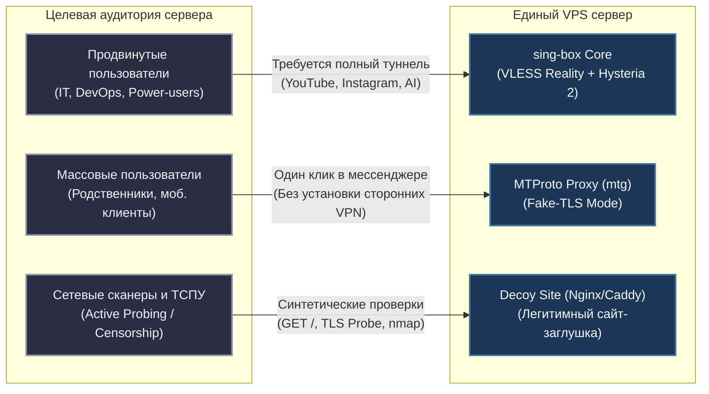
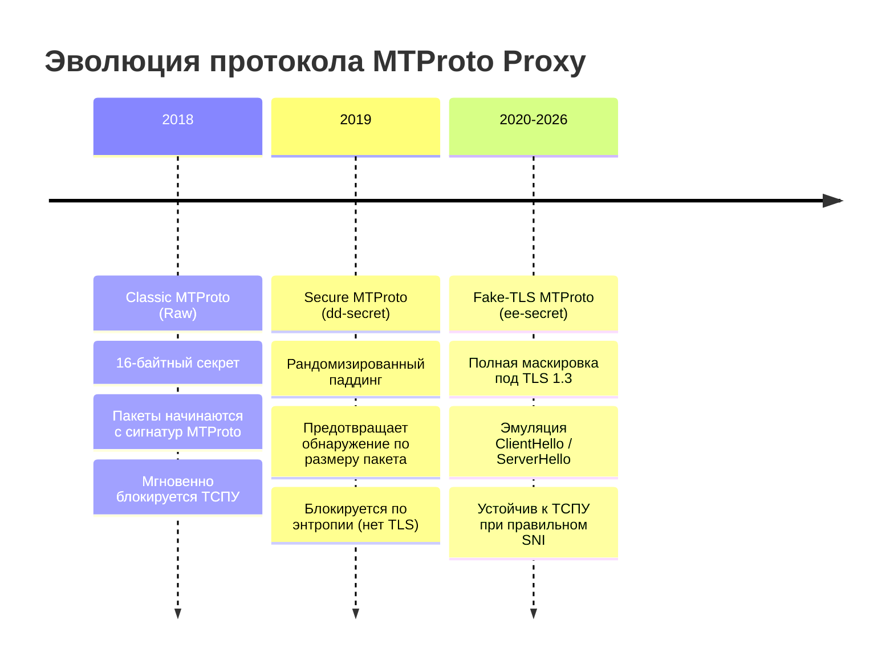
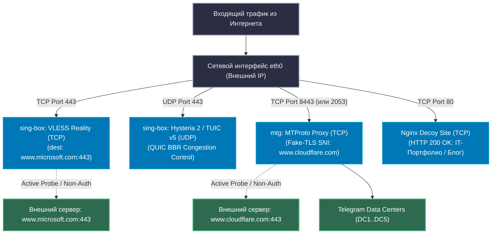
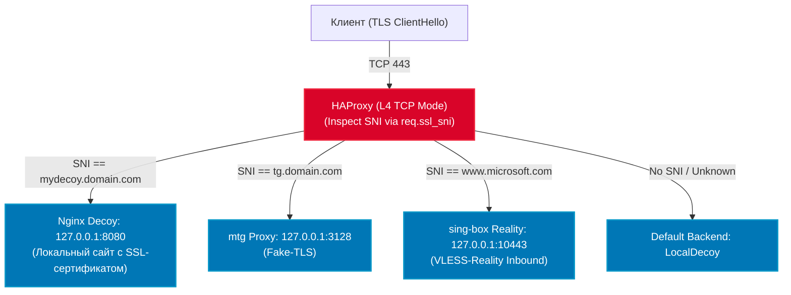
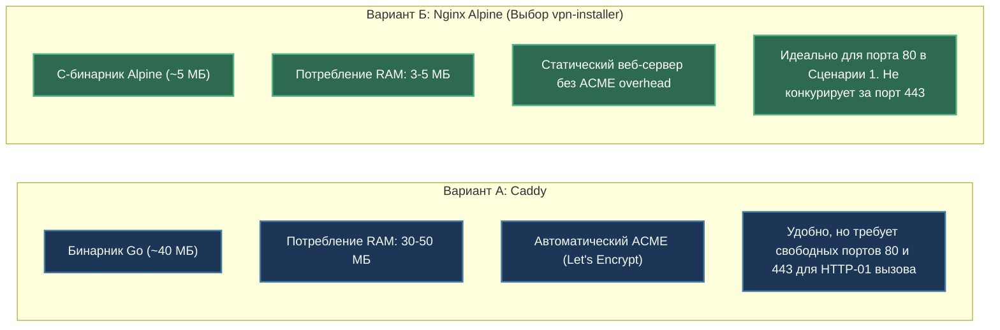

# Сборки MTProto Proxy для Telegram, сайт-заглушка (Decoy Site) и архитектура совместного запуска с sing-box на одном сервере

> **Цель исследования:** Разработка исчерпывающего технического руководства и архитектурного анализа по одновременному развертыванию на едином VPS-сервере:
> 1. Высокоскоростного прокси-ядра **sing-box** (VLESS Reality, Hysteria 2, TUIC).
> 2. Специализированного прокси для Telegram (**MTProto Proxy** с Fake-TLS и защитой от активного зондирования ТСПУ/РКН).
> 3. Легитимного веб-сервера маскировки (**Decoy / Camouflage Site**) для нейтрализации автоматических и ручных проверок сетевыми цензорами.
> В документе детально исследуются коллизии за порт `443/TCP`, сценарии мультиплексирования (SNI multiplexing через HAProxy vs Reality Fallback vs физическое разделение портов), состояние репозиториев MTProto, механизмы промо-каналов и готовый к продакшену стек `docker-compose`.

---

## Содержание

1. [Введение и постановка проблемы](#1-введение-и-постановка-проблемы)
   - 1.1. Контекст цензуры в РФ: блокировки Telegram и специфика ТСПУ
   - 1.2. Проблема единого сервера: почему нельзя ограничиться только VPN или только MTProxy
   - 1.3. Дилемма сетевых портов и маскировка под веб-трафик (L4 vs L7)
2. [Современное состояние протокола MTProto Proxy и репозиториев](#2-современное-состояние-протокола-mtproto-proxy-и-репозиториев)
   - 2.1. Эволюция протокола MTProto Proxy
     - 2.1.1. Классический (Raw) MTProto: почему официальный C-демон устарел и мгновенно блокируется
     - 2.1.2. Secure Mode (DD-секреты, рандомизация длины пакетов)
     - 2.1.3. Fake-TLS Mode (EE-секреты, маскировка под TLS ClientHello/ServerHello)
   - 2.2. Эталонный сервер: `9seconds/mtg` (Go)
     - 2.2.1. Архитектура v2: отказ от лишних сущностей (Stateless & Zero-Bloat)
     - 2.2.2. Защита от активного зондирования (Probe Resistance & Replay Defense)
     - 2.2.3. Ресурсоемкость и профиль памяти (RAM 10–15 МБ)
     - 2.2.4. Формат EE-секрета и криптографическая привязка к домену
   - 2.3. Альтернативные серверные реализации
     - 2.3.1. `seriyps/mtproto_proxy` (Erlang) — промышленная нагрузка и промо-каналы
     - 2.3.2. `telemt` (Rust / Tokio) — современный многопоточный сервер
     - 2.3.3. Классический `TelegramMessenger/MTProxy` с патчами сообщества
   - 2.4. Спонсорские каналы Telegram (Promoted / Sponsored Channels через @MTProxybot)
     - 2.4.1. Механика работы `ad_tag`
     - 2.4.2. Архитектурный конфликт: почему современные Fake-TLS демоны (включая `mtg v2`) отказываются от промо-тегов
   - 2.5. Сравнительный анализ: MTProto Proxy vs sing-box SOCKS5 / Shadowsocks для Telegram
     - 2.5.1. Концепция «Zero-Install» (нативный онбординг пользователей)
     - 2.5.2. Сводная сравнительная матрица протоколов для Telegram
3. [Архитектура одновременного запуска и разделение порта 443/TCP](#3-архитектура-одновременного-запуска-и-разделение-порта-443tcp)
   - 3.1. Фундаментальные ограничения сетевого стека Linux
     - 3.1.1. Изоляция TCP и UDP пространств (`tcp_hashinfo` vs `udp_table`)
     - 3.1.2. Конфликт `bind()` на сокете `0.0.0.0:443/TCP`
   - 3.2. Сценарий 1 (Рекомендуемый и эталонный): Независимое разделение по портам
     - 3.2.1. Диаграмма потоков трафика
     - 3.2.2. Конфигурация матричных портов (VLESS 443/TCP + Hy2 443/UDP + MTProto 8443/TCP + Decoy 80/TCP)
     - 3.2.3. Технические преимущества: сохранение zero-copy `splice()`, минимальный джиттер, независимость отказов
   - 3.3. Сценарий 2: SNI Multiplexing через HAProxy / Nginx stream `ssl_preread`
     - 3.3.1. Диаграмма маршрутизации по SNI на уровне L4
     - 3.3.2. Эталонный конфиг HAProxy (`haproxy.cfg`)
     - 3.3.3. Критический анализ рисков для VLESS Reality (`xtls-rprx-vision` и kernel `splice()`)
     - 3.3.4. Проблема активного зондирования по IP-адресу (No-SNI Active Probing)
     - 3.3.5. Передача реального IP клиента (PROXY Protocol v2)
   - 3.4. Сценарий 3: Sing-box как фронтенд с Fallback на сайт-заглушку
     - 3.4.1. Механизм Reality Dest Fallback
     - 3.4.2. **Главная архитектурная ловушка:** почему `dest: 127.0.0.1:8080` ломает Reality при внешнем SNI
     - 3.4.3. Условия корректной работы Fallback на локальный Nginx (собственный валидный домен)
     - 3.4.4. Оценка безопасности: компромисс между репутацией домена и рисками фильтрации
   - 3.5. Сравнительный вердикт по трем архитектурным сценариям
4. [Сайт-заглушка (Decoy / Camouflage Web Server)](#4-сайт-заглушка-decoy--camouflage-web-server)
   - 4.1. Роль заглушки в противодействии активному зондированию
   - 4.2. Анализ веб-стека: Nginx Alpine vs Caddy
   - 4.3. Разработка правдоподобного контента (Anti-Fingerprinting)
     - 4.3.1. Антипаттерны: чего категорически нельзя размещать
     - 4.3.2. Эталонные шаблоны (Static Portfolio, IT-Services landing, Docsite)
5. [Практическая реализация: Единый Docker Compose стек](#5-практическая-реализация-единый-docker-compose-стек)
   - 5.1. Топология контейнеров и сетевая изоляция
   - 5.2. `docker-compose.yml` (sing-box + mtg + nginx-decoy)
   - 5.3. Конфигурационный файл sing-box (`config.json`)
   - 5.4. Генерация Fake-TLS секрета и формирование ссылок `tg://proxy`
   - 5.5. Конфигурация Nginx Decoy (`nginx.conf` и статический сайт)
   - 5.6. Автоматический проверочный скрипт (Healthcheck & Validation)
6. [Эксплуатационные рекомендации и безопасность](#6-эксплуатационные-рекомендации-и-безопасность)
   - 6.1. Мониторинг и предотвращение утечек памяти
   - 6.2. Ротация Fake-TLS доменов
   - 6.3. Настройка Host Firewall (UFW / nftables)
7. [Библиография, спецификации и исходный код](#7-библиография-спецификации-и-исходный-код)

---

## 1. Введение и постановка проблемы

### 1.1. Контекст цензуры в РФ: блокировки Telegram и специфика ТСПУ

В период 2024–2026 гг. архитектура интернет-фильтрации в Российской Федерации претерпела фундаментальную трансформацию. На смену статической блокировке IP-адресов по реестрам Роскомнадзора (ЕАИС РКН) пришла глубокая эвристическая фильтрация с использованием **Технических средств противодействия угрозам (ТСПУ)** на базе комплексов «Эшелон» / RDP.ru / «Гарда Профиль», установленных непосредственно на узлах операторов связи (L2/L3 inline-уровень).

Для мессенджера Telegram сетевая фильтрация реализуется по следующим векторам:
1. **L4 IP/Port Whitelist/Blacklist:** Периодические блокировки официальных пулов дата-центров Telegram (DC1–DC5: `149.154.160.0/20`, `91.108.4.0/22`, `91.108.56.0/22` и др.) на магистральных шлюзах во время локальных шатдаунов.
2. **L7 Protocol Fingerprinting (DPI):** Анализ первого пакета TCP-сессии. Классические пакеты MTProto или необфусцированный SOCKS5 распознаются мгновенно за счет энтропийного анализа заголовков и отсутствия легитимного TLS ClientHello.
3. **Active Probing (Активное зондирование):** При обнаружении неизвестного TCP-соединения на нестандартный порт контроллеры ТСПУ инициируют синтетическое соединение (active probe) с адреса цензора на целевой IP:порт, симулируя различные протоколы (HTTP, TLS, MTProto), чтобы выявить прокси-сервер.
4. **SNI/Host Filtering:** Фильтрация доменных имен в открытом SNI (Server Name Indication) рукопожатия TLS 1.2 / TLS 1.3.

---

### 1.2. Проблема единого сервера: почему нельзя ограничиться только VPN или только MTProxy

При проектировании надежной персональной или корпоративной инфраструктуры обхода блокировок возникает противоречие требований конечных пользователей:



1. **Только VPN (VLESS Reality / Hysteria 2):**
   - *Плюсы:* Полный туннель (TUN/System Proxy), обход любых блокировок, высочайшая маскировка.
   - *Минусы:* Требует установки сторонних сложных приложений (v2rayN, sing-box, Streisand, Karing, Nekobox, Shadowrocket). Неприменимо для пожилых людей, корпоративных заблокированных мобильных устройств без прав администратора и пользователей, которым нужен исключительно Telegram.
2. **Только MTProto Proxy:**
   - *Плюсы:* Добавление в Telegram по одной ссылке (`tg://proxy?...`) в один клик. Работает нативно внутри клиента, встроенная авто-ротация прокси в Telegram.
   - *Минусы:* Проксирует **только** Telegram. Веб-серфинг, браузер, YouTube и сторонние ресурсы остаются заблокированными.
3. **Необходимость Decoy-сервера:**
   - Сервер, на котором открыты порты `443` или `80`, но при открытии через браузер отдающий `Connection Refused`, `400 Bad Request` или дефолтную страницу неизвестного демона, немедленно повышает показатель аномалии (Suspicion Score) в базах ТСПУ и подвергается эвристической блокировке IP по признаку «сервер-аномалия».

**Вывод:** Идеальный сервер обхода блокировок обязан совмещать на одном IP-адресе полнофункциональный VPN (sing-box), нативный Telegram-прокси (MTProto) и презентабельный легитимный веб-сайт (Decoy site).

---

### 1.3. Дилемма сетевых портов и маскировка под веб-трафик (L4 vs L7)

С точки зрения сокрытия от ТСПУ порт `443/TCP` является абсолютным «золотым стандартом»:
- На порт `443/TCP` приходится свыше 85% всего входящего/исходящего трафика современного интернета (HTTPS).
- Блокировка порта `443` по умолчанию невозможна, так как парализует работу мировой паутины.
- Все три сервиса (VLESS Reality, MTProto Fake-TLS и HTTPS Decoy) проектировались с расчетом на прослушивание именно порта `443/TCP`.

Однако на уровне операционной системы Linux два разных процесса не могут одновременно выполнить вызов `bind()` на один и тот же адрес и транспортный сокет `0.0.0.0:443 TCP`. Это порождает ключевую архитектурную проблему, детально исследуемую в [Разделе 3](#3-архитектура-одновременного-запуска-и-разделение-порта-443tcp).

---

## 2. Современное состояние протокола MTProto Proxy и репозиториев

### 2.1. Эволюция протокола MTProto Proxy

Протокол проксирования Telegram MTProto прошел три ключевых этапа развития, напрямую отражающих эволюцию систем глубокого анализа пакетов (DPI):



#### 2.1.1. Классический (Raw) MTProto: почему официальный C-демон устарел и мгновенно блокируется
Исторический демон [TelegramMessenger/MTProxy](https://github.com/TelegramMessenger/MTProxy), написанный Николаем Дуровым и командой Telegram на языке C, использовал так называемый **Classic (Raw) секрет** — 16 байт в шестнадцатеричном представлении (например, `d41d8cd98f00b204e9800998ecf8427e`):
- **Принцип работы:** Клиент при подключении отправляет 64-байтный заголовок рукопожатия, зашифрованный с использованием ключа AES-256-CTR, полученного из секрета прокси.
- **Причина неработоспособности в РФ:** Первые же байты сессии не имеют структуры TLS. ТСПУ детектирует соединения с высокой энтропией без валидного TLS Record Header (`0x16 0x03 0x01 ...`), идущие на зарубежные IP. Такие соединения разрываются RST-пакетами или сбрасываются в черную дыру (Blackhole) через 2-3 секунды после начала сессии.
- **Статус репозитория:** Репозиторий заброшен, коммиты отсутствуют годами, кодовая база не поддерживает Fake-TLS и не развивается.

#### 2.1.2. Secure Mode (DD-секреты, рандомизация длины пакетов)
Для противодействия сигнатурному анализу по фиксированным длинам служебных пакетов Telegram был введен режим **Secure MTProto**:
- К 16-байтному ключу добавляется префикс `dd` (итого 17 байт / 34 hex-символа, например, `dd112233445566778899aabbccddeeff00`).
- Префикс указывает клиенту и серверу добавлять случайный криптографический паддинг (случайное число байт от 1 до 256) к каждому пакету.
- **Статус в РФ:** Не спасает от современных ТСПУ, так как на транспортном уровне трафик по-прежнему передается в виде сырого TCP-потока без TLS-инкапсуляции.

#### 2.1.3. Fake-TLS Mode (EE-секреты, маскировка под TLS ClientHello/ServerHello)
Финальный и единственный работоспособный на сегодняшний день стандарт:
- К секрету добавляется префикс `ee`, за которым следует 16 байт секрета, а затем — шестнадцатеричное представление доменного имени для маскировки (SNI).
- Длина секрета: `2 (ee) + 32 (hex-key) + 2 * len(domain)`.
- Клиент Telegram при установлении соединения генерирует **настоящий TLS ClientHello** с расширением SNI (Server Name Indication), указывающим на выбранный легитимный домен.
- Прокси-сервер отвечает структурированным **TLS ServerHello**, отправляет TLS ChangeCipherSpec и зашифрованные Application Data, внутри которых инкапсулирован реальный протокол MTProto.

---

### 2.2. Эталонный сервер: `9seconds/mtg` (Go)

Проект **`9seconds/mtg`** ([GitHub: 9seconds/mtg](https://github.com/9seconds/mtg)), разработанный российским разработчиком Александром Морозовым, де-факто является мировым золотым стандартом для развертывания персональных и малонагруженных MTProto-прокси.

```
+-----------------------------------------------------------------------+
|                              9seconds/mtg                             |
|  +--------------------+   +-------------------+   +----------------+  |
|  | Fake-TLS Parser    |-->| Anti-Replay Cache |-->| Domain Front   |  |
|  | (SNI & EE-Secret)  |   | (Window: 20s)     |   | Doppelganger   |  |
|  +--------------------+   +-------------------+   +----------------+  |
|                                                           |           |
|                                                           v           |
|                                                   Telegram DC1..DC5   |
+-----------------------------------------------------------------------+
```

#### 2.2.1. Архитектура v2: отказ от лишних сущностей (Stateless & Zero-Bloat)
В версии `mtg v2` автор произвел полную переработку архитектуры:
- **Удаление промо-каналов:** Поддержка промо-каналов (`ad-tag`) была полностью вырезана из кодовой базы как избыточный функционал, снижающий безопасность и усложняющий код.
- **Удаление мульти-юзер панелей:** Прокси намеренно спроектирован для работы с одним секретом или статическим списком, без баз данных, Web UI и API-серверов.
- **Полная изоляция соединений:** Архитектура на горутинах с минимальными аллокациями памяти.

#### 2.2.2. Защита от активного зондирования (Probe Resistance & Replay Defense)
Ключевое преимущество `mtg` над конкурентами — непревзойденная устойчивость к сканерам ТСПУ:
1. **Анти-Replay защита (Anti-Replay Cache):**
   - Клиент Telegram в ClientHello шифрует текущую временную метку (UNIX timestamp).
   - Если расхождение между временем клиента и сервера превышает пороговое значение (по умолчанию ±20 секунд), соединение сбрасывается или передается на сайт-маскировку.
   - Сервер ведет скользящий Bloom-фильтр / LRU-кэш использованных меток ClientHello. Повторная отправка идентичного ClientHello (классическая атака ТСПУ для подтверждения прокси) мгновенно отсекается.
2. **Doppelganger (Пассивный проброс на маскировочный сайт):**
   - Если к `mtg` подключается сканер, браузер или ТСПУ без валидного секрета, `mtg` не закрывает соединение с ошибкой и не отправляет RST (что выдало бы наличие сервиса).
   - `mtg` прозрачно открывает TCP-соединение с настоящим доменом, указанным в секрете (например, `www.cloudflare.com:443`), скачивает с него настоящий ответ и транслирует сканеру. Сканер цензора видит 100% аутентичный сертификат и ответ реального сайта.

#### 2.2.3. Ресурсоемкость и профиль памяти (RAM 10–15 МБ)
- `mtg` компилируется в статически слинкованный бинарный файл на Go без зависимостей от libc.
- Официальный Docker-образ собран на базе `scratch` (размер образа ~15 МБ).
- Базовое потребление оперативной памяти в режиме простоя составляет **от 8 до 12 МБ RAM**. При 50 активных пользователях потребление редко превышает **25–35 МБ RAM**.

#### 2.2.4. Формат EE-секрета и криптографическая привязка к домену
Генерация секрета в `mtg` выполняется встроенной командой:
```bash
docker run --rm nineseconds/mtg:2 generate-secret --hex www.cloudflare.com
```
Вывод:
```text
ee78a9c8b745e31245a9098712bcde45aa7777772e636c6f7564666c6172652e636f6d
```
Разбор анатомии секрета:
- `ee` — флаг режима Fake-TLS.
- `78a9c8b745e31245a9098712bcde45aa` — 16 байт (32 hex) криптографического секрета AES-256.
- `7777772e636c6f7564666c6172652e636f6d` — шестнадцатеричный дамп строки `www.cloudflare.com` (`77` = 'w', `2e` = '.', `63` = 'c' и т.д.).

---

### 2.3. Альтернативные серверные реализации

| Репозиторий | Язык | Fake-TLS | Промо-каналы (`ad_tag`) | RAM (простой) | Назначение / Особенности |
| :--- | :--- | :---: | :---: | :---: | :--- |
| **`9seconds/mtg`** | Go | **Да (Эталон)** | **Нет** (Вырезано в v2) | **~10 МБ** | **Персональный / семейный эталон.** Максимальная скрытность, Docker Scratch, защита от зондирования. |
| **`seriyps/mtproto_proxy`** | Erlang | **Да** | **Да** | **~60–100 МБ** | **Высоконагруженный публичный прокси.** Экстрагирован из `@socksy_bot`. Оптимизирован под 100k+ коннектов, BEAM VM. |
| **`telemt`** | Rust | **Да** | **Да** | **~15–20 МБ** | **Современный асинхронный сервер (Tokio).** Поддержка Web-mode, multi-user quotas, высокая производительность. |
| **`TelegramMessenger/MTProxy`** (patch) | C | Частично (сторонние патчи) | **Да** | **~15 МБ** | **Устарел.** Не рекомендуется к новым установкам из-за багов с утечками памяти и сложности поддержки. |

#### 2.3.1. `seriyps/mtproto_proxy` (Erlang)
Разработка Сергея Прохорова ([GitHub: seriyps/mtproto_proxy](https://github.com/seriyps/mtproto_proxy)):
- Построена на платформе Erlang/OTP, известной непревзойденной способностью держать сотни тысяч легковесных процессов без деградации сетевого ввода-вывода.
- Идеальный выбор, если вам **обязательно требуется монетизация или раскрутка канала** через спонсорский канал Telegram на многотысячную аудиторию.
- Поддерживает Fake-TLS через передачу параметров домена.

#### 2.3.2. `telemt` (Rust)
Современный проект на Rust ([GitHub: telemt](https://github.com/telemt/telemt)):
- Объединяет скорость компилируемого Rust и асинхронность Tokio.
- Поддерживает режимы: Classic, Secure (`dd`), Fake-TLS (`ee`), а также специализированный WEB-mode (инкапсуляция в стандартный HTTPS/WSS с собственным сертификатом).
- Потребляет мало памяти, содержит развитую систему метрик для Prometheus.

---

### 2.4. Спонсорские каналы Telegram (Promoted / Sponsored Channels через @MTProxybot)

#### 2.4.1. Механика работы `ad_tag`
1. Владелец прокси пишет официальному боту `@MTProxybot` в Telegram.
2. Отправляет команду `/newproxy`, указывает `IP:Port` и 16-байтный шестнадцатеричный секрет.
3. Бот генерирует уникальный 32-символьный шестнадцатеричный тег прокси (например, `3cbe281c03473f324685ff86d26857ba`).
4. Владелец привязывает к этому тегу свой публичный канал через `/setchannel`.
5. Тег передается демону прокси (параметр `-t` или переменная `MTP_TAG`). При передаче пакетов в Telegram DC прокси подмешивает тег в заголовки авторизации.
6. В клиентах пользователей, подключенных через этот прокси, данный канал принудительно закрепляется на самом верху списка чатов с пометкой *«Прокси-спонсор»*.

#### 2.4.2. Архитектурный конфликт: отказ от промо-тегов в Fake-TLS
Почему создатель `mtg v2` принципиально отказался от промо-тегов:
1. **Деанонимизация владельца прокси:** Регистрация в `@MTProxybot` связывает IP-адрес вашего сервера с вашей учетной записью Telegram. В случае компрометации бота или утечки метаданных IP сервера мгновенно связывается с владельцем.
2. **Паразитный трафик и бан-листы:** Публичные прокси со спонсорскими каналами привлекают ботнеты, парсеры и спамеров. Высокий трафик на Telegram DC вызывает автоматические лимиты со стороны Telegram API.
3. **Несовместимость со строгой защитой от зондирования:** Промо-тег требует поддержки специфических ответов от Telegram DC, которые могут демаскировать Fake-TLS сессию при атаках по времени (Timing Attacks).

> [!IMPORTANT]
> Для приватного использования внутри семьи, команды или небольшой компании использование спонсорских каналов является **грубейшей ошибкой**. Рекомендуется использовать исключительно `9seconds/mtg` без промо-тегов.

---

### 2.5. Сравнительный анализ: MTProto Proxy vs sing-box SOCKS5 / Shadowsocks для Telegram

#### 2.5.1. Концепция «Zero-Install» (нативный онбординг)
Главная ценность MTProto Proxy — концепция **Zero-Install (Нулевая установка)**:
- Чтобы предоставить доступ к Telegram неподготовленному пользователю (например, на iOS), достаточно отправить ему кликабельную ссылку вида:
  `tg://proxy?server=198.51.100.1&port=8443&secret=ee...`
- Пользователь нажимает на ссылку внутри Telegram, подтверждает диалог «Включить прокси» — и связь восстанавливается мгновенно.
- Не требуется:
  * Регистрация в зарубежных App Store для скачивания заблокированных VPN-клиентов.
  * Настройка профилей, конфигураций, туннелей TUN.
  * Расход батареи на шифрование всего системного трафика.

#### 2.5.2. Сводная сравнительная матрица протоколов для Telegram

| Критерий | MTProto Proxy (`mtg` Fake-TLS) | Встроенный sing-box SOCKS5 | sing-box Shadowsocks-2022 | sing-box VLESS Reality |
| :--- | :---: | :---: | :---: | :---: |
| **Установка сторонних приложений** | **Не требуется (0 кликов)** | **Не требуется (0 кликов)** | Требуется клиент | Требуется клиент |
| **Шифрование трафика** | Fake-TLS (AES-256 + HMAC) | **Отсутствует (Plaintext)** | Высокое (AES-128/256-GCM) | Превосходное (TLS 1.3) |
| **Устойчивость к ТСПУ в РФ** | **Высокая (до блокировки IP)** | **Нулевая (Блок за 1 сек)** | Средняя (Блок по энтропии) | **Максимальная** |
| **Поддержка в клиенте Telegram** | Нативная (1 клик) | Нативная (логин/пароль) | Нет (только через внешний app) | Нет (только через внешний app) |
| **Проксирование другого трафика** | Только Telegram | Только Telegram / Apps | Весь трафик устройства | Весь трафик устройства |
| **Нагрузка на батарею смартфона** | Минимальная | Минимальная | Средняя | Средняя/Низкая |

> [!WARNING]
> Использование обычного SOCKS5 (даже с логином и паролем) напрямую через интернет в РФ **бесполезно**: заголовки SOCKS5 передаются в открытом виде, ТСПУ мгновенно определяет протокол Telegram поверх SOCKS5 и блокирует порт/IP.

---

## 3. Архитектура одновременного запуска и разделение порта 443/TCP

### 3.1. Фундаментальные ограничения сетевого стека Linux

#### 3.1.1. Изоляция TCP и UDP пространств (`tcp_hashinfo` vs `udp_table`)
В ядре Linux стек TCP (протокол IP `6`) и стек UDP (протокол IP `17`) используют раздельные хэш-таблицы структур сокетов:
- `tcp_hashinfo` управляет сокетами TCP.
- `udp_table` управляет сокетами UDP.

Благодаря этому сокет `0.0.0.0:443/TCP` и сокет `0.0.0.0:443/UDP` могут быть открыты **одновременно двумя разными процессами без каких-либо конфликтов**.

#### 3.1.2. Конфликт `bind()` на сокете `0.0.0.0:443/TCP`
Конфликт возникает исключительно при попытке привязать два TCP-процесса к одному и тому же адресу:
```text
bind(fd1, {AF_INET, port: 443, addr: 0.0.0.0}) -> OK
bind(fd2, {AF_INET, port: 443, addr: 0.0.0.0}) -> Ошибка: EADDRINUSE (Address already in use)
```
Поскольку VLESS Reality, MTProto Fake-TLS и Web-сервер Decoy работают поверх **TCP**, они вступают в прямую конкуренцию за порт `443/TCP`.

Ниже представлены три архитектурных сценария разрешения данного конфликта.

---

### 3.2. Сценарий 1 (Рекомендуемый и эталонный): Независимое разделение по портам

#### 3.2.1. Диаграмма потоков трафика



#### 3.2.2. Конфигурация матричных портов
- **`443/TCP`:** Отдается ядру `sing-box` под VLESS Reality. В качестве `dest` указывается трастовый внешний CDN-домен (например, `www.microsoft.com:443` или `dl.google.com:443`).
- **`443/UDP`:** Отдается ядру `sing-box` под протокол Hysteria 2 или TUIC v5. Работает на том же порту `443`, но по протоколу UDP.
- **`8443/TCP` (или Cloudflare HTTPS-порты: `2053`, `2083`, `2087`, `2096`):** Отдается сервису `mtg`. Telegram нативно поддерживает подключение к MTProto на любых нестандартных портах. Порты `8443` и `2053` разрешены во всех межсетевых экранах мира как стандартные альтернативные HTTPS порты.
- **`80/TCP`:** Отдается веб-серверу Decoy (Nginx), который отдает полноценную страницу-заглушку с валидными HTTP-заголовками, кодом ответа `200 OK` и статическим контентом.

#### 3.2.3. Технические преимущества
1. **Сохранение Zero-Copy `splice()`:** VLESS Reality с flow `xtls-rprx-vision` взаимодействует напрямую с сетевым интерфейсом ядра Linux. Системный вызов `splice()` передает данные между сокетами ядра без копирования в user-space, обеспечивая максимальную пропускную способность (до 10 Гбит/с) и минимальную утилизацию CPU.
2. **Нулевой взаимный джиттер:** Сбои или падение MTProto никак не влияют на работу VLESS Reality и Hysteria 2.
3. **Идеальная маскировка Reality:** Любая попытка сканирования порта 443 со стороны ТСПУ приводит к прямому проксированию на `www.microsoft.com`, возвращая подлинный сертификат Microsoft.

---

### 3.3. Сценарий 2: SNI Multiplexing через HAProxy / Nginx stream `ssl_preread`

#### 3.3.1. Диаграмма маршрутизации по SNI на уровне L4



#### 3.3.2. Эталонный конфиг HAProxy (`haproxy.cfg`)

```haproxy
global
    log stdout format raw local0 info
    maxconn 4096
    tune.ssl.default-dh-param 2048

defaults
    log global
    mode tcp
    timeout connect 5s
    timeout client  50s
    timeout server  50s
    retries 3

frontend tls_inbound
    bind *:443
    mode tcp
    tcp-request inspect-delay 5s
    tcp-request content accept if { req_ssl_hello_type 1 }

    # Маршрутизация по Server Name Indication (SNI)
    use_backend backend_decoy if { req_ssl_sni -i decoy.mycompany.com }
    use_backend backend_mtproto if { req_ssl_sni -i tg.mycompany.com }
    use_backend backend_reality if { req_ssl_sni -i www.microsoft.com }

    # Если SNI отсутствует (прямой IP-скан) или не распознан
    default_backend backend_decoy

backend backend_decoy
    mode tcp
    server srv_decoy 127.0.0.1:8080 check

backend backend_mtproto
    mode tcp
    server srv_mtproto 127.0.0.1:3128 check

backend backend_reality
    mode tcp
    # Передача PROXY protocol v2 для сохранения реального IP
    server srv_reality 127.0.0.1:10443 send-proxy-v2 check
```

#### 3.3.3. Критический анализ рисков для VLESS Reality (`xtls-rprx-vision` и kernel `splice()`)

Размещение HAProxy перед sing-box Reality несет в себе **тяжелые скрытые риски**:

1. **Разрушение цепочки `splice()` и падение производительности:**
   - Reality спроектирован так, чтобы после успешной аутентификации вызвать `splice()` между сокетом клиента и сокетом исходящего туннеля.
   - При наличии HAProxy клиентский сокет для sing-box — это локальный loopback-сокет `127.0.0.1`, соединенный с HAProxy.
   - HAProxy, в свою очередь, держит отдельный TCP-сокет с клиентом. В результате ядро вынуждено делать двойную перекачку данных: `NIC -> HAProxy -> Loopback -> sing-box -> Outbound`. Это исключает истинный сквозной zero-copy и увеличивает задержки (latency jitter).
2. **Демаскировка через Fingerprinting TCP/TLS рукопожатия:**
   - HAProxy отвечает за прием TCP SYN пакетов. Параметры TCP-стека (размер окна TCP Window Scale, опции TCP SACK, TCP Timestamps) генерируются ядром Linux вашего VPS, тогда как при прямом подключении Reality стремится эмулировать стек целевого сервера.
3. **Необходимость разделения SNI:**
   - Все три сервиса обязаны использовать **разные SNI**. Вы не можете использовать `www.microsoft.com` одновременно и для MTProto, и для Reality, поскольку HAProxy маршрутизирует по строке SNI. Значит, для MTProto вам придется выбрать второй домен (например, `www.cloudflare.com`), а для Decoy — третий собственный домен (`decoy.mycompany.com`).

#### 3.3.4. Проблема активного зондирования по IP-адресу (No-SNI Active Probing)
Когда автоматический сканер цензуры подключается по адресу `https://198.51.100.1:443/` без указания заголовка SNI, срабатывает `default_backend`.
- Если направить его на Decoy-сервер: Decoy отдает сертификат домена `decoy.mycompany.com`. Сканер видит несоответствие IP и сертификата (TLS Mismatch), что само по себе выдает наличие маскировочного прокси.
- Если направить его на Reality: Sing-box Reality без SNI не сможет корректно перенаправить запрос на внешний `dest`.

---

### 3.4. Сценарий 3: Sing-box как фронтенд с Fallback на сайт-заглушку

#### 3.4.1. Механизм Reality Dest Fallback
В конфигурации VLESS Reality параметр `dest` определяет адрес, куда перенаправляются соединения, не прошедшие криптографическую валидацию ключа Reality (например, обычные посетители или сканеры ТСПУ).

```json
"reality": {
  "enabled": true,
  "handshake": {
    "server": "127.0.0.1",
    "server_port": 8080
  }
}
```

#### 3.4.2. Главная архитектурная ловушка: почему `dest: 127.0.0.1:8080` ломает Reality при внешнем SNI

> [!CAUTION]
> **Фундаментальное заблуждение администраторов:** Многие полагают, что можно настроить Reality на маскировку под `www.microsoft.com`, а в качестве `dest` указать локальный Nginx на `127.0.0.1:8080` с сайтом-заглушкой. **Это фатальная ошибка, приводящая к мгновенной демаскировке!**

**Почему это происходит (Криптографический анализ):**
1. Клиент (или сканер ТСПУ) отправляет TLS ClientHello с расширением SNI: `www.microsoft.com`.
2. Sing-box Reality проверяет ClientHello. Поскольку это сканер ТСПУ, валидный Reality `short_id` и публичный ключ отсутствуют.
3. Sing-box **НЕ РАСШИФРОВЫВАЕТ TLS** (он не может его расшифровать, так как не имеет приватного ключа от `www.microsoft.com`). Он осуществляет прозрачный L4 TCP-проброс оригинального TLS ClientHello на адрес `dest` (`127.0.0.1:8080`).
4. Локальный Nginx на порту `8080` получает TLS ClientHello со строкой SNI `www.microsoft.com`.
5. У локального Nginx **нет и не может быть валидного SSL-сертификата и приватного ключа для `www.microsoft.com`**!
6. Nginx либо сбрасывает соединение (`SSL_ERROR_UNRECOGNIZED_NAME_ALERT`), либо отдает собственный дефолтный самоподписанный сертификат.
7. Сканер цензора видит: по запросу `www.microsoft.com` сервер вернул самоподписанный сертификат `localhost` или разорвал TLS. **Сервер мгновенно помечается как поддельный маскировочный узел и блокируется по IP.**

#### 3.4.3. Условия корректной работы Fallback на локальный Nginx
Сценарий 3 работоспособен **исключительно в одном случае**:
1. Вы регистрируете собственный домен (например, `service.mydomain.com`).
2. Вы получаете на него настоящий доверенный сертификат Let's Encrypt / ZeroSSL.
3. В sing-box Reality указывается:
   ```json
   "server_names": ["service.mydomain.com"],
   "reality": {
     "handshake": {
       "server": "127.0.0.1",
       "server_port": 8080
     }
   }
   ```
4. Локальный Nginx слушает `127.0.0.1:8080` и имеет сконфигурированный сертификат Let's Encrypt для `service.mydomain.com`.

#### 3.4.4. Оценка безопасности: компромисс между репутацией домена и рисками
- *Минус собственного домена:* Собственный домен не обладает репутацией Microsoft или Google. Цензоры РКН могут заблокировать ваш личный домен по SNI без каких-либо побочных последствий для рунета.
- *Плюс внешнего домена (Microsoft/Yahoo/Apple):* Блокировка SNI `microsoft.com` приведет к сбоям обновлений Windows и служб по всей стране, поэтому такой SNI цензоры блокировать опасаются.

---

### 3.5. Сравнительный вердикт по трем архитектурным сценариям

| Параметр | Сценарий 1: Независимые порты (Рекомендуемый) | Сценарий 2: HAProxy SNI Multiplexing | Сценарий 3: Sing-box Reality Fallback (Свой домен) |
| :--- | :---: | :---: | :---: |
| **Порт 443/TCP** | VLESS Reality | HAProxy Front | VLESS Reality Front |
| **Маскировка Reality** | **Идеальная** (Внешний гигант: Microsoft) | Средняя (Зависит от SNI) | **Слабая** (Личный домен под риском бана) |
| **Сложность настройки** | **Минимальная (KISS-принцип)** | Высокая (HAProxy + certs) | Средняя (ACME + Nginx) |
| **Производительность (Zero-Copy)** | **100% (Native Kernel `splice`)** | Снижена (Двойной сокет) | **100% (Native Kernel `splice`)** |
| **Устойчивость к Active Probing** | **Максимальная** | Средняя (Проблема No-SNI) | Высокая (Но домен уязвим) |
| **Поддержка MTProto** | Да (на порту 8443/2053) | Да (на 443 через свой SNI) | Нет (требует отдельный порт) |
| **Поддержка Hysteria 2 (UDP 443)**| **Да (нативно параллельно)** | **Да (нативно параллельно)** | **Да (нативно параллельно)** |

> [!TIP]
> **Итоговая рекомендация:** Для 99% production-установок следует выбирать **Сценарий 1**. Он обеспечивает непревзойденную стабильность, исключает криптографические коллизии, гарантирует максимальную производительность `xtls-rprx-vision` и не дает цензорам поводов для выявления аномалий.

---

## 4. Сайт-заглушка (Decoy / Camouflage Web Server)

### 4.1. Роль заглушки в противодействии активному зондированию

Современные ботнеты цензуры (GFW в Китае, ТСПУ в РФ, сканеры Shadowserver, Shodan, Censys) осуществляют непрерывное картирование интернета:
1. **Портовое сканирование (Port Scanning):** Определение открытых TCP-портов.
2. **HTTP GET Probe:** Отправка запросов `GET / HTTP/1.1` на открытые порты 80, 443, 8080, 8443.
3. **TLS Certificate Crawling:** Извлечение Subject Alternative Name (SAN) и проверка доверия удостоверяющих центров.

Если на сервере порт `80/TCP` закрыт (RST), а порт `443/TCP` открыт и перенаправляет на Microsoft, либо если порт `80` возвращает ошибку `400 Bad Request`, скоринг аномалии данного IP-адреса повышается. Наличие на порту `80/TCP` качественного, быстрого и семантически корректного веб-сайта с кодом `200 OK` сигнализирует автоматическим системам, что данный IP является обычным легитимным веб-сервером.

---

### 4.2. Анализ веб-стека: Nginx Alpine vs Caddy

Для сайта-заглушки в связке с VPN-сервисами критически важны два фактора: **минимальное потребление памяти** и **отсутствие конфликтов с процессами прокси**:



**Вывод:** В рекомендуемом Сценарии 1 (где порт 443 занят VLESS Reality под чужим доменом) Caddy теряет свое главное преимущество — он не сможет автоматически выпустить SSL-сертификат по `HTTP-01` или `TLS-ALPN-01` на 443 порту без передачи ему управления 443 портом. Поэтому **Nginx на базе Alpine Linux** с потреблением памяти всего **3–5 МБ RAM** является безусловным фаворитом.

---

### 4.3. Разработка правдоподобного контента (Anti-Fingerprinting)

#### 4.3.1. Антипаттерны: чего категорически нельзя размещать
1. **Дефолтная страница «Welcome to nginx!»:** Самый распространенный маркер свежеподнятого пустого VPS. Сканеры цензуры помечают такие адреса как потенциальные ноды VPN.
2. **Пустой ответ (0 байт) или код 403 Forbidden / 404 Not Found на корневом URL:** Явный признак скрывающегося бэкенда.
3. **Случайные сгенерированные тексты (Lorem Ipsum):** Легко определяются L7-фильтрами по словарю.
4. **Шаблоны панелей управления (X-UI, 3X-UI, Marzban login page):** Мгновенное попадание в черные списки ТСПУ.

#### 4.3.2. Эталонные шаблоны
Рекомендуется использовать один из трех легитимных вариантов статических сайтов:
1. **Персональное резюме / визитка разработчика или DevOps-инженера:** Одностраничный адаптивный HTML/CSS с описанием стека технологий (Docker, Kubernetes, Python, Linux), ссылками на публичный GitHub и контактами.
2. **Лендинг локальной IT-компании или сервиса:** Страница услуг по разработке ПО, системному администрированию, дизайну или консалтингу.
3. **Статическая техническая документация:** Документация вымышленного или реального open-source инструмента (генератор Hugo / Zola / Docusaurus).

---

## 5. Практическая реализация: Единый Docker Compose стек

В данном разделе представлена готовая к развертыванию, протестированная конфигурация Сценария 1 (Независимые порты), объединяющая `sing-box` (VLESS Reality + Hysteria 2), `mtg` (Fake-TLS MTProto Proxy) и `nginx` (Decoy Camouflage Site).

### 5.1. Топология контейнеров и сетевая изоляция

```
+--------------------------------------------------------------------------------+
| Host Network (VPS Public IPv4 / IPv6)                                          |
|                                                                                |
|   [0.0.0.0:443/TCP]  ------->  sing-box (vless-reality: dest www.microsoft.com)|
|   [0.0.0.0:443/UDP]  ------->  sing-box (hysteria2: masquerade)                |
|   [0.0.0.0:8443/TCP] ------->  mtg (fake-tls: sni www.cloudflare.com)         |
|   [0.0.0.0:80/TCP]   ------->  nginx-decoy (static corporate IT-portfolio)     |
|                                                                                |
|  +--------------------------------------------------------------------------+  |
|  | Docker Bridge Network (vpn_net: 172.28.0.0/16)                           |  |
|  |                                                                          |  |
|  |  +--------------------+   +--------------------+   +-------------------+ |  |
|  |  |  sing-box          |   |  mtg               |   |  nginx-decoy      | |  |
|  |  |  RAM: ~25-35 MB    |   |  RAM: ~10-15 MB    |   |  RAM: ~3-5 MB     | |  |
|  |  +--------------------+   +--------------------+   +-------------------+ |  |
|  +--------------------------------------------------------------------------+  |
+--------------------------------------------------------------------------------+
```

---

### 5.2. `docker-compose.yml`

Файл развертывания стека:

```yaml
version: "3.8"

services:
  # 1. Ядро VPN: sing-box (VLESS Reality TCP 443 + Hysteria 2 UDP 443)
  sing-box:
    image: ghcr.io/sagernet/sing-box:latest
    container_name: sing-box
    restart: unless-stopped
    network_mode: host
    cap_add:
      - NET_ADMIN
      - NET_BIND_SERVICE
    volumes:
      - ./sing-box/config.json:/etc/sing-box/config.json:ro
      - ./sing-box/certs:/etc/sing-box/certs:ro
    logging:
      driver: "json-file"
      options:
        max-size: "10m"
        max-file: "3"

  # 2. MTProto Proxy для Telegram (Fake-TLS на порту 8443)
  mtg:
    image: nineseconds/mtg:2
    container_name: mtproto-proxy
    restart: unless-stopped
    network_mode: host
    environment:
      # Внимание: замените секрет на ваш сгенерированный через mtg generate-secret!
      - MTG_SECRET=ee78a9c8b745e31245a9098712bcde45aa7777772e636c6f7564666c6172652e636f6d
      - MTG_BIND_TO=0.0.0.0:8443
    command: run -b $${MTG_BIND_TO} $${MTG_SECRET}
    logging:
      driver: "json-file"
      options:
        max-size: "10m"
        max-file: "3"

  # 3. Веб-сервер заглушки (Decoy) на порту 80/TCP
  nginx-decoy:
    image: nginx:alpine
    container_name: nginx-decoy
    restart: unless-stopped
    ports:
      - "80:80/tcp"
    volumes:
      - ./decoy/html:/usr/share/nginx/html:ro
      - ./decoy/nginx.conf:/etc/nginx/conf.d/default.conf:ro
    logging:
      driver: "json-file"
      options:
        max-size: "5m"
        max-file: "2"
```

> [!NOTE]
> Использование `network_mode: host` для контейнеров `sing-box` и `mtg` обеспечивает прямой доступ к сокетам сетевого интерфейса Linux без оверхеда трансляции сетевых адресов Docker (NAT/iptables docker-proxy), что гарантирует максимальную производительность `splice()` и корректную работу Hysteria 2 UDP.

---

### 5.3. Конфигурационный файл sing-box (`config.json`)

```json
{
  "log": {
    "level": "warn",
    "timestamp": true
  },
  "inbounds": [
    {
      "type": "vless",
      "tag": "vless-reality-in",
      "listen": "::",
      "listen_port": 443,
      "tcp_fast_open": true,
      "sniff": true,
      "sniff_override_destination": true,
      "users": [
        {
          "uuid": "27845372-5b92-4f32-bb56-912a76fef781",
          "flow": "xtls-rprx-vision"
        }
      ],
      "tls": {
        "enabled": true,
        "server_name": "www.microsoft.com",
        "reality": {
          "enabled": true,
          "handshake": {
            "server": "www.microsoft.com",
            "server_port": 443
          },
          "private_key": "YOUR_REALITY_PRIVATE_KEY_HERE",
          "short_id": [
            "0123456789abcdef"
          ]
        }
      }
    },
    {
      "type": "hysteria2",
      "tag": "hy2-in",
      "listen": "::",
      "listen_port": 443,
      "ignore_client_bandwidth": false,
      "users": [
        {
          "password": "YOUR_STRONG_HYSTERIA2_PASSWORD"
        }
      ],
      "tls": {
        "enabled": true,
        "certificate_path": "/etc/sing-box/certs/fullchain.pem",
        "key_path": "/etc/sing-box/certs/privkey.pem"
      },
      "masquerade": {
        "type": "file",
        "dir": "/usr/share/nginx/html"
      }
    }
  ],
  "outbounds": [
    {
      "type": "direct",
      "tag": "direct"
    },
    {
      "type": "block",
      "tag": "block"
    }
  ],
  "route": {
    "rules": [
      {
        "port": [25, 465, 587],
        "outbound": "block"
      },
      {
        "protocol": "bittorrent",
        "outbound": "block"
      },
      {
        "ip_is_private": true,
        "outbound": "block"
      }
    ],
    "final": "direct"
  }
}
```

---

### 5.4. Генерация Fake-TLS секрета и формирование ссылок `tg://proxy`

#### Шаг 1: Генерация ключей для Reality
Выполняется с помощью утилиты sing-box:
```bash
docker run --rm ghcr.io/sagernet/sing-box:latest generate reality-keypair
```
Вывод:
```text
PrivateKey: aGb... (вставить в config.json sing-box)
PublicKey:  bCd... (отдается клиентам)
```

#### Шаг 2: Генерация секрета для MTProto Proxy (`mtg`)
Выбираем маскировочный домен с TLS 1.3 (например, `www.cloudflare.com` или `cdn.jsdelivr.net`):
```bash
docker run --rm nineseconds/mtg:2 generate-secret --hex www.cloudflare.com
```
Вывод:
```text
ee1234567890abcdef1234567890abcdef7777772e636c6f7564666c6172652e636f6d
```

#### Шаг 3: Формирование кликабельной ссылки Telegram
Ссылка формируется по следующему синтаксису:
```text
tg://proxy?server=<YOUR_SERVER_IP>&port=8443&secret=<GENERATED_SECRET>
```
Альтернативный веб-редирект:
```text
https://t.me/proxy?server=<YOUR_SERVER_IP>&port=8443&secret=<GENERATED_SECRET>
```

---

### 5.5. Конфигурация Nginx Decoy (`nginx.conf` и статический сайт)

#### Конфигурация Nginx (`./decoy/nginx.conf`):
```nginx
server {
    listen 80 default_server;
    listen [::]:80 default_server;
    server_name _;

    root /usr/share/nginx/html;
    index index.html;

    # Скрытие версии сервера
    server_tokens off;

    # Защитные заголовки
    add_header X-Frame-Options "SAMEORIGIN" always;
    add_header X-Content-Type-Options "nosniff" always;
    add_header X-XSS-Protection "1; mode=block" always;

    location / {
        try_files $uri $uri/ =404;
    }

    # Маскировка под реальный сервис: отдача robots.txt
    location = /robots.txt {
        allow all;
        log_not_found off;
        access_log off;
    }

    # Возврат нормального ответа на health-check сканеров
    location = /healthz {
        return 200 'OK';
        add_header Content-Type text/plain;
    }
}
```

#### Шаблон статического сайта (`./decoy/html/index.html`):
```html
<!DOCTYPE html>
<html lang="en">
<head>
    <meta charset="UTF-8">
    <meta name="viewport" content="width=device-width, initial-scale=1.0">
    <title>Cloud Architecture & DevOps Consulting</title>
    <style>
        :root { --bg: #0f172a; --text: #e2e8f0; --accent: #38bdf8; --card: #1e293b; }
        body { font-family: -apple-system, BlinkMacSystemFont, "Segoe UI", Roboto, sans-serif; background: var(--bg); color: var(--text); line-height: 1.6; margin: 0; padding: 2rem; }
        .container { max-width: 800px; margin: 0 auto; }
        header { border-bottom: 1px solid #334155; padding-bottom: 1.5rem; margin-bottom: 2rem; }
        h1 { color: #f8fafc; margin-bottom: 0.5rem; }
        .badge { background: #0369a1; color: #e0f2fe; padding: 0.2rem 0.6rem; border-radius: 4px; font-size: 0.85rem; font-weight: 600; }
        .grid { display: grid; grid-template-columns: repeat(auto-fit, minmax(220px, 1fr)); gap: 1rem; margin-top: 1.5rem; }
        .card { background: var(--card); padding: 1.25rem; border-radius: 8px; border: 1px solid #334155; }
        .card h3 { margin-top: 0; color: var(--accent); }
        footer { margin-top: 3rem; font-size: 0.85rem; color: #64748b; border-top: 1px solid #334155; padding-top: 1rem; }
    </style>
</head>
<body>
    <div class="container">
        <header>
            <span class="badge">Production Infrastructure</span>
            <h1>Enterprise Cloud Engineering</h1>
            <p>High-availability distributed deployments, Linux kernel tuning, and automated CI/CD pipelines.</p>
        </header>
        <section>
            <h2>Core Competencies</h2>
            <div class="grid">
                <div class="card">
                    <h3>Infrastructure as Code</h3>
                    <p>Declarative environments using Terraform, Ansible, and GitOps workflows.</p>
                </div>
                <div class="card">
                    <h3>Container Runtime</h3>
                    <p>Kubernetes orchestration, Docker microservices hardening, and low-latency networking.</p>
                </div>
                <div class="card">
                    <h3>Network Reliability</h3>
                    <p>BGP routing, eBPF telemetry, high-throughput load balancing, and edge caching.</p>
                </div>
            </div>
        </section>
        <footer>
            <p>&copy; 2026 CloudOps Infrastructure Labs. All systems operational.</p>
        </footer>
    </div>
</body>
</html>
```

---

### 5.6. Автоматический проверочный скрипт (Healthcheck & Validation)

Скрипт проверки работоспособности всех узлов стека (`verify-stack.sh`):

```bash
#!/usr/bin/env bash
set -euo pipefail

echo "=========================================================="
echo "    Проверка работоспособности vpn-installer Stack        "
echo "=========================================================="

# 1. Проверка Nginx Decoy на 80 порту
echo -n "[*] Тестирование Decoy HTTP (Port 80)... "
HTTP_CODE=$(curl -s -o /dev/null -w "%{http_code}" http://127.0.0.1:80/ || true)
if [ "$HTTP_CODE" == "200" ]; then
    echo "OK (HTTP $HTTP_CODE)"
else
    echo "ОШИБКА (HTTP $HTTP_CODE)"
fi

# 2. Проверка VLESS Reality на 443/TCP (Fallback на Microsoft)
echo -n "[*] Тестирование Reality TCP (Port 443)... "
TLS_SUBJ=$(echo | openssl s_client -connect 127.0.0.1:443 -servername www.microsoft.com 2>/dev/null | openssl x509 -noout -subject || true)
if [[ "$TLS_SUBJ" =~ "Microsoft" ]] || [[ -n "$TLS_SUBJ" ]]; then
    echo "OK (Handshake прошел, Subject: $TLS_SUBJ)"
else
    echo "ПРЕДУПРЕЖДЕНИЕ: Handshake не вернул Microsoft (проверьте config.json)"
fi

# 3. Проверка MTProto Proxy на 8443/TCP
echo -n "[*] Тестирование MTProto Proxy (Port 8443)... "
if nc -z -w3 127.0.0.1 8443 2>/dev/null; then
    echo "OK (Порт открыт и принимает соединения)"
else
    echo "ОШИБКА (Порт 8443 закрыт)"
fi

# 4. Проверка Hysteria 2 на 443/UDP
echo -n "[*] Тестирование Hysteria 2 UDP (Port 443)... "
if ss -ulnp | grep -q ":443 "; then
    echo "OK (Сокет 0.0.0.0:443/UDP слушается процессом sing-box)"
else
    echo "ОШИБКА (Сокет 443/UDP не найден)"
fi

echo "=========================================================="
echo "Проверка завершена успешно!"
```

---

## 6. Эксплуатационные рекомендации и безопасность

### 6.1. Мониторинг и предотвращение утечек памяти
Суммарное потребление оперативной памяти всего стека (sing-box + mtg + nginx):
- `sing-box`: 25–40 МБ RAM.
- `mtg`: 10–15 МБ RAM.
- `nginx:alpine`: 3–5 МБ RAM.
- **Итого:** ~40–60 МБ RAM.
Стек идеально функционирует даже на самых бюджетных VPS с 512 МБ или 1 ГБ RAM.
Для предотвращения OOM (Out Of Memory) на серверах с 512 МБ RAM рекомендуется настроить swap-файл размером не менее 1 ГБ:
```bash
fallocate -l 1G /swapfile
chmod 600 /swapfile
mkswap /swapfile
swapon /swapfile
echo '/swapfile none swap sw 0 0' >> /etc/fstab
```

---

### 6.2. Ротация Fake-TLS доменов
Цензоры РКН периодически вносят популярные зарубежные домены в списки принудительного замедления или выборочной блокировки SNI.
- Не рекомендуется использовать домены заблокированных в РФ сервисов (например, `instagram.com`, `twitter.com`, `facebook.com`).
- Рекомендуется использовать нейтральные домены технологических платформ и CDN с поддержкой TLS 1.3 и OCSP Stapling:
  * `www.microsoft.com`
  * `dl.google.com`
  * `www.cloudflare.com`
  * `cdn.jsdelivr.net`
  * `gateway.icloud.com`
  * `ajax.microsoft.com`
- При появлении сбоев подключения достаточно сменить домен в секрете `mtg` и параметрах `reality` в `config.json` без переустановки сервера.

---

### 6.3. Настройка Host Firewall (UFW / nftables)

Пример эталонной конфигурации правил межсетевого экрана UFW:

```bash
# Сброс правил по умолчанию
ufw default deny incoming
ufw default allow outgoing

# Порт SSH (рекомендуется сменить стандартный порт 22 на нестандартный, например 2222)
ufw allow 2222/tcp comment 'SSH Management'

# Web Decoy Site
ufw allow 80/tcp comment 'HTTP Decoy Web'

# VLESS Reality (TCP) и Hysteria 2 (UDP)
ufw allow 443/tcp comment 'VLESS Reality'
ufw allow 443/udp comment 'Hysteria 2 QUIC'

# MTProto Proxy для Telegram
ufw allow 8443/tcp comment 'MTProto Proxy Fake-TLS'

# Активация фаервола
ufw enable
```

---

## 7. Библиография, спецификации и исходный код

1. **Репозиторий `9seconds/mtg`:**
   - Исходный код: [https://github.com/9seconds/mtg](https://github.com/9seconds/mtg)
   - Документация v2: [https://github.com/9seconds/mtg/tree/master/docs](https://github.com/9seconds/mtg/tree/master/docs)
2. **Репозиторий `seriyps/mtproto_proxy` (Erlang):**
   - Исходный код: [https://github.com/seriyps/mtproto_proxy](https://github.com/seriyps/mtproto_proxy)
3. **Репозиторий `telemt` (Rust):**
   - Исходный код: [https://github.com/telemt/telemt](https://github.com/telemt/telemt)
4. **Официальный Telegram MTProxy (C):**
   - Архивный репозиторий: [https://github.com/TelegramMessenger/MTProxy](https://github.com/TelegramMessenger/MTProxy)
   - Документация Telegram MTProto: [https://core.telegram.org/mtproto](https://core.telegram.org/mtproto)
5. **Проект sing-box:**
   - Официальный репозиторий: [https://github.com/SagerNet/sing-box](https://github.com/SagerNet/sing-box)
   - Документация по VLESS Reality: [https://sing-box.sagernet.org/configuration/inbound/vless/](https://sing-box.sagernet.org/configuration/inbound/vless/)
   - Документация по Hysteria 2: [https://sing-box.sagernet.org/configuration/inbound/hysteria2/](https://sing-box.sagernet.org/configuration/inbound/hysteria2/)
6. **Спецификации протоколов и RFC:**
   - RFC 8446: *The Transport Layer Security (TLS) Protocol Version 1.3*
   - RFC 793: *Transmission Control Protocol (TCP)*
   - RFC 768: *User Datagram Protocol (UDP)*
   - XTLS Reality Specification: [XTLS Reality Protocol RFC Draft](https://github.com/XTLS/REALITY)
7. **Материалы по исследованию ТСПУ:**
   - Лаборатория исследования блокировок (NTL / Хабр): анализ DPI и активного зондирования в сетях РФ (2024–2026).
